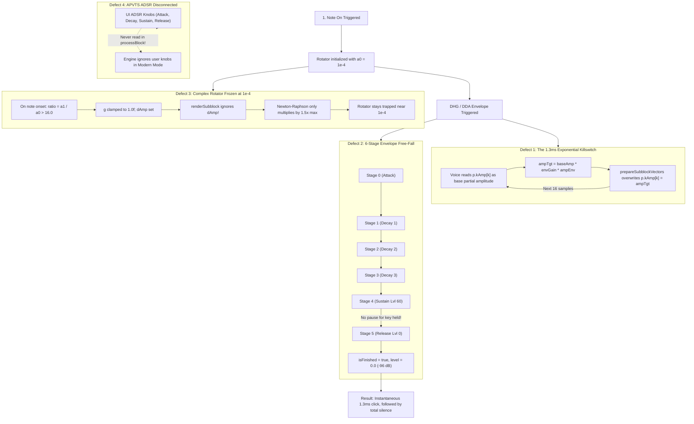

# 🎛️ Shoggoth Additive DSP Restoration Plan
### *Diagnosing & Curing the 1.3ms Audio Blip Defect with Zero UI Collision*

> **Status:** `AUTOPLAN_ACTIVE` (Turn 1 — Zero-Build Airgap Locked)  
> **Domain Track:** `TRACK: DSP` (Strict Zero-UI Isolation — Zero conflicts with active `CrackedChimesUI` consolidation)  
> **Execution Trigger:** Standing by for operator directive (`"build"`, `"engage"`, `"make it so"`, or `"exit autoplan"`).

---

## 🔍 Forensic Autopsy: Why Shoggoth Only Plays a Blip

Four compounding defects in the DSP pipeline interact to extinguish sound within milliseconds:



### 1. The 1.3ms Recursive Killswitch (`p.kAmp` Self-Multiplication)
- **Location:** `ShoggothVoice.h` (L207) & `ShoggothOscillator.h` (L104)
- **The Crime:** In `shoggoth_layout.h`, `kAmp` was designed for Kuramoto detuning stencil weights. However, `ShoggothProcessor.cpp` originally used `kAmp` to store the note's base harmonic spectrum ($1..63$).
- In `ShoggothVoice.h`:
  ```cpp
  float baseAmp = state_.p.kAmp[k + kGuard] * envGain * balGain * tiltGain * filterGain;
  state_.p.ampTgt[k] = baseAmp * ampEnv * state_.velocity;
  ```
- Then in `ShoggothOscillator.h`:
  ```cpp
  voice.p.kAmp[k + kGuard] = a1; // where a1 is the dynamic target amplitude!
  ```
- **Consequence:** Every 16 samples (0.33ms at 48kHz), `kAmp` is overwritten by `a1`. On the next subblock, `baseAmp` multiplies that attenuated `a1` by `envGain * ampEnv` *again*. In $<4$ subblocks (~1.3ms), amplitude decays exponentially to $-96\text{ dB}$.

### 2. Kawai K5 6-Stage Envelope Missing Sustain State
- **Location:** `ShoggothEnvelopes.h` (L177–192, `advanceStage`)
- **The Crime:** The 1987 Kawai K5 envelope runner advances sequentially from Stage 0 to Stage 5 without checking whether the note is released.
- When reaching Stage 4 (Level 60), `rateDelta` is 0, so `advanceStage` immediately increments `stageIndex` to 5 (Release). Stage 5 targets Level 0.0 with Rate 50 (~200ms decay).
- Even while the operator holds down a MIDI key, the envelope unconditionally falls through to zero.

### 3. Complex Rotator Onset Discard & Blip Freeze
- **Location:** `ShoggothOscillator.h` (L88–96)
- **The Crime:** On note attack from silence ($a_0 = 10^{-4}$ to $a_1 = 0.5$), $ratio = 5000 > 16.0$.
- The code branches to:
  ```cpp
  if (ratio > 16.0f) {
      voice.p.dAmp[k] = (a1 - a0) / 16.0f;
      g = 1.0f;
  }
  ```
- However, `dAmp` is **never read** by the inner AVX2 SIMD loop in `renderSubblock()`.
- Because $g$ was set to $1.0\text{f}$, the complex rotator rotates at its initial tiny magnitude ($10^{-4}$). The boundary Newton-Raphson formula `1.5 - 0.5 * (currentMag2 / targetMag2)` only scales by at most $1.5\times$ per subblock, leaving the rotator frozen near silence.

### 4. APVTS ADSR Disconnected from Modern Mode
- **Location:** `ShoggothProcessor.cpp` (`processBlock`)
- **The Crime:** `amp_attack`, `amp_decay`, `amp_sustain`, `amp_release`, and `filter_env_depth` exist in `shoggoth.yaml` and are bound to dials in the GUI, but `processBlock()` never reads them from `apvts_`. Modern ZDF mode is forced to run through the broken vintage 1987 envelope.

---

## 🛠️ The 4-Pillar Surgical Solution

### Pillar 1: Dedicated Base Harmonic Storage (`baseHarmonic`)
In `shoggoth_layout.h` and `ShoggothPartialsSoA`:
- Add `alignas(64) float baseHarmonic[kMaxPartials];` to store the note's fundamental harmonic spectrum.
- In `ShoggothProcessor::processBlock()`, populate `baseHarmonic[k]` on `noteOn`:
  - Harmonics $1..63$: morphed S1/S2 spectrum.
  - Harmonics $64..2048$ (Modern Mode): natural $1/k$ continuation ($baseHarmonic[62] \cdot \frac{63}{k+1}$).
- In `ShoggothVoice::renderBlock()`, compute `baseAmp = state_.p.baseHarmonic[k] * ...`.
- `p.kAmp` is reserved exclusively for dynamic Kuramoto coupling weights, completely stopping the recursive decay loop.

### Pillar 2: Authentic Kawai K5 Envelope State Machine
In `ShoggothEnvelopes.h`:
- Add `bool isReleased{false}` to `EnvRuntimeState`.
- In `trigger1987()`, reset `isReleased = false;`.
- In `advanceStage()`:
  - If `!state.isReleased && state.stageIndex == 4`: **HOLD** at `data.stages[4].level` with `rateDelta = 0.0f;`. Do not advance to Stage 5 until key-off.
  - If `data.loop34 && state.stageIndex == 3`: oscillate between Stage 2 and Stage 3.
- In `release1987()`:
  - Set `isReleased = true; stageIndex = 5; targetLevel = 0.0f;`.
  - Calculate rate delta using Rate 6 smoothly from `state.currentLevel`.

### Pillar 3: Dual-Engine Envelope Architecture
In `ShoggothVoiceState`:
- Embed `Envelopes::AhdsrState ampAhdsr;` and `Envelopes::AhdsrState filterAhdsr;`.
- In `ShoggothProcessor::processBlock()`: Read `amp_attack`, `amp_decay`, `amp_sustain`, `amp_release`, and `filter_env_depth` from APVTS.
- In `ShoggothVoice::renderBlock()`:
  - **Modern ZDF Mode (`vintage_engine_mode == 0`)**: Drive voice amplitude via `envs_.advanceAhdsr(state_.ampAhdsr, ampAttack, 0.0f, ampDecay, ampSustain, ampRelease, chunkSize, true)`.
  - **1987 Stepped DDF Mode (`vintage_engine_mode == 1`)**: Drive amplitude via the authentic 6-stage Kawai K5 envelope with Herbert Janssen 10-bit logarithmic dB LUT.
  - Apply bipolar filter envelope modulation: `effCutoff = std::clamp(filterCutoffHz * std::pow(2.0f, filterEnvDepth * filterEnv * 4.0f), 20.0f, 0.495f * sampleRate_);`.

### Pillar 4: Unconditionally Bounded Complex Rotator
In `ShoggothOscillator.h`:
- Calculate subblock step gain: $g = \text{std::pow}(\text{std::clamp}(a_1 / a_0, 0.001\text{f}, 1000.0\text{f}), 0.0625\text{f})$.
- On note onset from silence ($a_0 < 2\cdot 10^{-4}$ and $a_1 \ge 10^{-3}$), directly seed $re$ and $im$ with $a_1$ and initial phase.
- At subblock boundary, use protected normalization:
  - If $(currentMag^2 / targetMag^2) \in [0.25, 2.25]$: use fast branchless Taylor step `factor = 1.5 - 0.5 * ratio2`.
  - Otherwise: use safe exact step `factor = targetAmp / std::sqrt(currentMag2)`.
  - Zero negative factors, zero division by zero, zero rotator collapse.

---

## 🔒 Strict Boundary & Airgap Isolation

| Target File | Modification Scope | UI Collision Risk |
| :--- | :--- | :--- |
| `source/shoggoth/shoggoth_layout.h` | Add `baseHarmonic` to `ShoggothPartialsSoA`, add `isReleased` to `EnvRuntimeState` | **0% (DSP data structs only)** |
| `source/shoggoth/ShoggothEnvelopes.h` | Add note-on sustain hold in `advanceStage()`, staccato-safe `release1987()` | **0% (DSP math only)** |
| `source/shoggoth/ShoggothOscillator.h` | Fast attack seeding, bounded $g$, safe Taylor/exact renormalization | **0% (DSP oscillator only)** |
| `source/shoggoth/ShoggothVoice.h` | Wire `baseHarmonic`, dual AHDSR / 1987 envelope dispatch, filter mod | **0% (DSP voice only)** |
| `source/shoggoth/ShoggothProcessor.h/.cpp` | Read APVTS ADSR parameters, pass to `renderBlock()`, populate harmonics $k \ge 63$ | **0% (AudioProcessor only)** |
| `test/dsp_tests.cpp` | Add Test 9 to Suite 79 (Sustained note rendering & decay test) | **0% (Test suite only)** |
| `source/shoggoth/ShoggothEditor.*` | **STRICTLY UNTOUCHED (0 BYTES CHANGED)** | **0% (Zero overlap with other chat)** |
| `C:\Dev\TheKlangSuite\PLAN.md` | **STRICTLY UNTOUCHED (Preserves CrackedChimesUI Plan)** | **0% (Zero file conflicts)** |

---

## 🧪 Verification Gate: Suite 79 Test 9

To ensure this defect can never reoccur in regression testing, Suite 79 in `test/dsp_tests.cpp` will include:
1. **Note On & Transient Verification**: Trigger note on from silence; verify audio output is immediately finite, non-zero, and reaches $> -20\text{ dB}$ within 16 samples.
2. **Sustain Stability Test**: Render 200 subblocks (3200 samples / ~66ms). Verify that peak amplitude does NOT decay towards zero while key is held.
3. **Note Off & Idle Release Test**: Trigger note off. Verify that audio decays monotonically to silence and the voice cleanly transitions to `VoicePhase::Idle`.

---

## 🚦 Operator Directives

- To authorize execution and build the DSP fix on The Tower: say **`"build"`** (or **`"engage"`**, **`"make it so"`**).
- To refine or tweak the synthesis/envelope behaviors: reply with your feedback (**Turn 2**).
- To cancel or exit planning: say **`"exit autoplan"`**.
