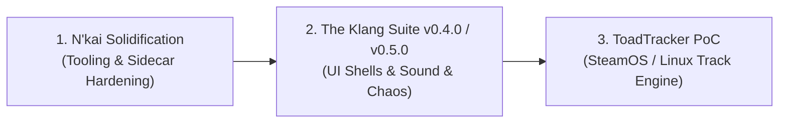

# 🧭 The North Star Focus Anchor (`docs/FOCUS.md`)

> **The Living Compass of New Klang City**  
> *Last Updated: 2026-10-11* | *Ecosystem State: Active*  
> **Current Primary Focus:** `N'kai Hardening & Runway Execution`

---

## 🎯 Active Mission & Priority Runway

Solo vibe-coding across multiple repositories thrives on velocity, but falters when multiple projects demand active architectural attention simultaneously. To eliminate context fragmentation, exactly **one repository holds active focus at any given moment**.

### The Sequence of Precedence:


1. **Current Active Driver — N'kai Solidification (`v0.2.0`)**:
   - Complete the foundational runway: Universal UTF-8 audit, QA Sandbox Board (`rj-03`), Unified Master Template (`rj-04`), Multi-Board Hub (`rj-05`), and Mailbag Intake v2 (`rj-07`).
   - Get the tooling rock solid so all future creative sessions have an unshakeable, 0ms triage foundation.
2. **Next Up — The Klang Suite (`v0.4.0-dev` $\to$ `v0.5.0-dev`)**:
   - Wrap Milestone v0.4.1 (Complete Control Surface & UI Shells).
   - Advance to Milestone v0.5.0 ("The Sound & Chaos Update") for heavy DSP and modular synthesis.
3. **Horizon Target — ToadTracker (`v0.1.0`)**:
   - Stand up the core headless tracker engine and 500Hz SteamOS / Linux gamepad input pipeline.

---

## 🏛️ The Four Pillars: Current Matrix

| Pillar | Repository | Active Branch | SemVer | Status & Role |
| :--- | :--- | :--- | :--- | :--- |
| **N'kai** | [`nkai`](file:///c:/Dev/nkai) | `main` | `v0.2.0` | 🔨 **ACTIVE FOCUS**: Native Antigravity Extension, zero-copy IPC, and triage boards. |
| **The Klang Suite** | [`TheKlangSuite`](file:///c:/Dev/TheKlangSuite) | `0.4.0-dev` | `v0.4.0` | ⏳ **STANDBY**: Milestone v0.4.0 UI shell execution queued immediately after N'kai runway. |
| **ToadTracker** | [`ToadTracker`](file:///c:/Dev/ToadTracker) | `main` | `v0.1.0` | ⏳ **PARKED**: Architecture & Steam Deck specs approved; audio PoC follows TKS milestones. |
| **The Klang Research** | [`TheKlangResearch`](file:///C:/Dev/Research) | `main` | Living Hub | 📚 **LIVING**: Shared research hub for deep RFCs, autopsies, and architectural teardowns. |

---

## 🚫 Negative Architecture (What We Are NOT Doing Right Now)

To prevent scope creep and rabbit holes, the following boundaries are strictly enforced:

1. **NO Mobile Companion (`v0.3.0`)**:
   - Mobile touch layouts and Wi-Fi LAN companion pairing remain deferred until the desktop Antigravity UI extension (`v0.2.0`) is battle-tested.
2. **NO DAW Engine Plumbing**:
   - We do not build monolithic DAW engines or patch legacy tape engines. The Klang Suite builds VST3 audio plugins; ToadTracker builds a lightweight, zero-allocation tracker core.
3. **NO Premature DSP Implementation in TKS**:
   - No experimental DSP math or oscillator code is to be authored for TKS until the UI control surface shells in Milestone v0.4.1 are completed and verified by `gui_tests`.
4. **NO Speculative Moonshots**:
   - All speculative ideas (Tracktion DAW scaffolding, firmware hacking, Obsidian app forks) remain parked in [`docs/MOONSHOTS.md`](file:///c:/Dev/TheKlangSuite/docs/MOONSHOTS.md).

---

## 🧭 The Gentle Re-Centering Nudge Protocol

Exploratory spikes, deep research labs, and creative tangents are vital to high-level engineering. However, to prevent "rabbit hole amnesia", agents must follow the **Gentle Nudge Protocol**:

- **When to Apply**: Immediately following a deep research report, blind stress test, or creative detour.
- **How to Apply**: Output a single-sentence, non-blocking compass check in chat:
  > 🧭 **North Star Check**: Returning from *[Detour Topic]* to active focus: **[Current Pillar & Active Flight]**.
- **Invariant**: This is a **nudge, not a gate**. It never blocks the user, requires no confirmation modal, and simply keeps the active horizon in plain sight.

---

## 🏷️ The Ambient Status Line Standard

Every conversational turn in active chat sessions carries the ambient status line in the response footer:

```text
Focus: N'kai hardening | TKS-0.4.0 · TT-0.1.0 · NK-0.2.0 · TR-Active
```

*(When an interactive N'kai triage board is actively open, append `· [ 📬 Open N'kai Board ](sidecar://nkai/panel/)` to the end of the line. On routine coding and docs turns, omit the link to keep transcripts clean.)*
