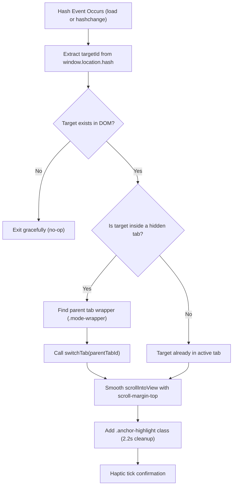

# N'kai Cumulative Allowance Ledger & Token Governance Architecture (Topics 6.3 & 6.19)

## 1. Architectural Intent & Scope

The **N'kai Asymmetric Sidecar Framework** (`nkai`) provides visual side-panel environments and triage workbenches for human-agent pair programming. As research and architectural exploration progress, complex multi-topic roadmaps are formed across the Four Pillars (`TheKlangSuite`, `ToadTracker`, `nkai`, `TheKlangResearch`).

Without strict token economics and navigation governance, AI pair-programming pipelines encounter two critical friction points:
1. **The Fragmented Canvas Hazard**: Dividing research topics into separate, disconnected HTML files causes loss of holistic perspective, broken cross-references, state divergence, and awkward window switching.
2. **The Unbounded Token Burn Trap**: Dispatching sprawling multi-task implementation plans to autonomous agents without proactive cost estimation causes unexpected token quota depletion, model degradation mid-flight, rate-limiting, and severe friction for human operators managing daily API allowances.

This specification unifies the solution across two synergistic domains:
- **Topic 6.3 (Approved Option B — Deep-Linked Monolithic Board Architecture)**: A single living research canvas housing all topics, indexed through URL hash-anchor routing (`#t1`, `#t2`, `#autopsy`), sticky header compensation (`scroll-margin-top`), and seamless cross-tab focus highlights.
- **Topic 6.19 (Approved Option C — Live Cumulative Cost Meter & Budget Ledger)**: Real-time cumulative token burn calculation, multi-tier budget heuristics (Tier 1 Pro vs. Tier 2 Flash vs. Tier 3 Flash Low), visual threshold color bands (Safe, Warning, Critical), and offline CLI ledger auditing.

---

## 2. Topic 6.3: Deep-Linked Monolithic Board Architecture

### 2.1 The Monolithic Advantage & The Navigation Challenge

Splitting research across dozens of independent HTML files degrades developer velocity:
- Global state (triage decisions, notes, session packages) becomes siloed.
- Comparative analysis across topics requires tab hopping.
- Cross-topic synthesis (e.g., assessing DSP computational load against UI layout constraints) becomes nearly impossible.

Option B preserves the **Monolithic Living Board** while eliminating spatial disorientation through deterministic, deep-linkable URL routing.

### 2.2 Deep-Link URL Hash Contracts

Every distinct topic, workshop card, autopsy entry, and primary view possesses a unique, human-readable DOM identifier. The URL hash reflects and controls the active viewport:

```
https://.../research_board.html#t1.1         <-- Deep links directly to Topic 1.1 card
https://.../research_board.html#autopsy      <-- Deep links directly to the Ongoing Autopsy View
https://.../research_board.html#dsp          <-- Deep links to DSP Architecture Tab
```

#### Hash Schema Hierarchy
| Target Type | Hash Pattern | DOM Element ID | Behavior on Navigation |
| :--- | :--- | :--- | :--- |
| **Top-Level View / Tab** | `#<mode>` | `tab-<mode>`, `<mode>-mode` | Switches active view tab; scrolls to top (`y = 0`). |
| **Specific Topic / Card** | `#t<id>` or `#<id>` | `topic-<id>`, `card-<id>`, `<id>` | Activates parent tab if inactive; scrolls card to top; triggers `.anchor-highlight`. |
| **Sub-Section / Stage** | `#sec-<slug>` | `sec-<slug>` | Activates parent tab; scrolls to section heading. |
| **Scoreboard / Meter** | `#ledger` or `#autopsy` | `tab-autopsy`, `triage-scoreboard` | Activates autopsy tab; focuses the allowance ledger. |

### 2.3 Sticky Header Offset (`scroll-margin-top`)

Under N'kai's Two-Tier Header Architecture (Topics 6.9 & 6.10), the persistent application header occupies approximately $72\text{px}$–$100\text{px}$ of viewport height depending on responsive breakpoints.

Standard browser `scrollIntoView()` or default hash navigation causes the target element's top edge to align with viewport $y = 0$, burying the card header directly underneath the opaque sticky header (the "Buried Header Defect").

To guarantee 100% visibility of target headings and action chips, all deep-linkable cards, sections, and topics enforce:
```css
.topic-card,
.stage-card,
.autopsy-feed-item,
section[id],
div[id^="t"],
div[id^="topic-"] {
  scroll-margin-top: 110px;
}
```

### 2.4 Focus Pulse & Anchor Highlighting

When an external link or user action navigates to a card via a hash anchor, the user needs immediate visual confirmation of the focused card. N'kai implements both CSS `:target` pseudo-class styling and a dynamic `.anchor-highlight` CSS class:

```css
:target,
.anchor-highlight {
  animation: anchor-pulse 2.2s cubic-bezier(0.16, 1, 0.3, 1) forwards;
}

@keyframes anchor-pulse {
  0% {
    box-shadow: 0 0 0 0 rgba(88, 166, 255, 0.8), 0 0 24px rgba(88, 166, 255, 0.4);
    border-color: var(--accent-blue, #58a6ff);
  }
  30% {
    box-shadow: 0 0 0 6px rgba(88, 166, 255, 0.25), 0 0 32px rgba(88, 166, 255, 0.3);
    border-color: var(--accent-blue, #58a6ff);
  }
  100% {
    box-shadow: 0 0 0 0 rgba(88, 166, 255, 0);
  }
}
```

### 2.5 Hash-Change Router State Machine



The router listens to both `window.addEventListener('hashchange', ...)` and `window.addEventListener('DOMContentLoaded', ...)` to restore tab and card focus seamlessly on page reloads or deep-link clicks.

---

## 3. Topic 6.19: Live Cumulative Cost Meter & Budget Ledger

### 3.1 Model Tier Token Burn Rate Heuristics

AI agents operating in large-scale codebases consume input context, output generations, and reasoning/thinking tokens at predictable rates depending on the model tier and problem complexity.

Based on empirical data across hundreds of engineering sprints in `TheKlangSuite`, token burn rates are calibrated into three canonical heuristics:

```
┌───────────────────────────────────────────────────────────────────────────────────────┐
│                           MODEL TIER TOKEN BURN HEURISTICS                            │
│                                                                                       │
│  [ Tier 1: Pro High ]         ~40,000 tokens/task  │  ⚠️ HIGH QUOTA IMPACT            │
│  - Deep DSP differential equations, non-linear saturation proofs, lock-free threads   │
│                                                                                       │
│  [ Tier 2: Flash High ]       ~10,000 tokens/task  │  🟢 SUSTAINABLE (Universal)      │
│  - JUCE UI components, APVTS bindings, unit test expansions, standard implementations │
│                                                                                       │
│  [ Tier 3: Flash Low/Med ]    ~2,000 tokens/task   │  ⚡ MINIMAL IMPACT               │
│  - JSON schema tweaks, mechanical find-and-replace, documentation updates, CMake flags│
└───────────────────────────────────────────────────────────────────────────────────────┘
```

#### Task Classification Matrix
| Tier | Model | Default Tokens | Qualifying Workloads |
| :--- | :--- | :--- | :--- |
| **Tier 1** | Gemini 3.1 Pro (Thinking: High) | **40,000** | Non-linear DSP saturation, polyphonic voice allocation, lock-free concurrency, differential equations, core architecture overhauls. |
| **Tier 2** | Gemini 3.8 Flash (Thinking: High) | **10,000** *(Default)* | Standard UI components, APVTS bindings, C++ feature implementations, automated test suites (`dsp_tests`, `gui_tests`), N'kai sidecar controllers. |
| **Tier 3** | Gemini 3.8 Flash (Low/Medium) | **2,000** | JSON schema updates (`assets/controls/`), documentation reconciliation (`docs/specs/`), mechanical string replacements, simple CMake adjustments. |

### 3.2 Dynamic Card Tier Declaration

In N'kai interactive boards, each proposal or topic card specifies its anticipated implementation tier via HTML `data-tier` attributes or domain tags:

```html
<div class="topic-card" id="card-1.1" data-tier="tier1" data-domain="dsp">
  <span class="badge tier-badge tier-1">Tier 1 Pro High (~40k)</span>
  <!-- Card content -->
</div>
```

If `data-tier` is omitted, the framework applies deterministic fallback inference:
1. Card tagged `dsp`, `math`, `concurrency`, `threading` $\rightarrow$ **Tier 1 (40k)**.
2. Card tagged `docs`, `schema`, `chore`, `metadata` $\rightarrow$ **Tier 3 (2k)**.
3. All other cards $\rightarrow$ **Tier 2 (10k)** *(Universal Default)*.

---

## 4. Cumulative Allowance Ledger Data Model

### 4.1 Token Accumulation Engine

The ledger recalculates in real-time whenever a triage verdict changes (`APPROVE`, `TABLE`, `KILL`, `PENDING`):

$$\text{Tokens}_{\text{Approved}} = \sum_{c \in \text{Approved}} \text{Cost}(Tier(c))$$

$$\text{Tasks}_{\text{Approved}} = |\text{Approved}|$$

The ledger maintains separate sub-totals for each model tier to illuminate quota composition:
- $\text{Tokens}_{\text{T1}} = \sum_{c \in \text{Approved}_{T1}} 40{,}000$
- $\text{Tokens}_{\text{T2}} = \sum_{c \in \text{Approved}_{T2}} 10{,}000$
- $\text{Tokens}_{\text{T3}} = \sum_{c \in \text{Approved}_{T3}} 2{,}000$

### 4.2 Threshold Color Bands & Proactive Budget Warning

To prevent runaway planning marathons, the cumulative token total is classified into three semantic health bands:

```
  0k                               100k                              200k                       ∞
┌───────────────────────────────────┬─────────────────────────────────┬───────────────────────────┐
│     🟢 SAFE BAND (<= 100k)        │    🟡 WARNING BAND (101k-200k)  │  🔴 CRITICAL BAND (>200k) │
│     Proceed with Confidence       │    Multi-Sprint Flight Alert    │  Quota Exhaustion Block   │
└───────────────────────────────────┴─────────────────────────────────┴───────────────────────────┘
```

1. **Safe Band ($\le 100{,}000$ tokens)** — `.meter-safe` (Emerald `#34d399`):
   - Scope is compact and sustainable for a single pair-programming session.
   - Low risk of API rate limits or daily allowance burn.
   - Planner status: `CLEAR TO PROCEED`.
2. **Warning Band ($101{,}000$ – $200{,}000$ tokens)** — `.meter-warning` (Amber `#fbbf24`):
   - Multi-sprint flight requiring coordinated execution.
   - Advises the planner to verify whether Tier 1 tasks can be re-architected into Tier 2 blueprints.
   - Recommends decomposing into staged milestones (`Flight A`, `Flight B`).
3. **Critical Band ($> 200{,}000$ tokens)** — `.meter-critical` (Rose `#f87171`):
   - **Proactive Budget Gate**: Threatens operator daily token allowances and risks mid-flight stalls.
   - The UI displays an alert badge: `⚠️ QUOTA WARNING: Exceeds 200k tokens. Decompose before dispatching.`
   - Autonomous planning agents MUST pause and request operator confirmation before promoting to `PLAN.md`.

---

## 5. UI Presentation & Components

### 5.1 Dual-Placement Architecture

The allowance meter appears in two strategic locations across the N'kai workbench:
1. **Persistent Header Cluster**: Compact token pill (`.allowance-meter`) in the top-tier header, visible across all tabs.
2. **Autopsy Scoreboard Bar**: Rich, segmented progress meter (`.allowance-bar`) in the Ongoing Autopsy view alongside status pills (Approved, Tabled, Killed).

```
┌───────────────────────────────────────────────────────────────────────────────────────┐
│ HEADER TIER TOP                                                                       │
│  [ Brand ]                  [ 🔋 Tokens: ~52k (Safe) ]  [ Haptics ] [ Zoom ] [ Reload ] │
└───────────────────────────────────────────────────────────────────────────────────────┘
  ...
┌───────────────────────────────────────────────────────────────────────────────────────┐
│ AUTOPSY SCOREBOARD                                                                    │
│  [ Total: 7 ]  [ Approved: 3 ]  [ Tabled: 2 ]  [ Killed: 1 ]  [ Pending: 1 ]          │
│                                                                                       │
│  Cumulative Token Budget: 52,000 / 200,000 tokens  (SAFE 🟢)                          │
│  ┌─────────────────────────────────┬───────────┬─┬────────────────────────────────────┐
│  │ ████ Tier 1 Pro (40k)           │ ██ T2(10k)│█│  Available Allowance (148k)       │
│  └─────────────────────────────────┴───────────┴─┴────────────────────────────────────┘
│  [ ℹ️ View Breakdown ]                                            [ Copy Verdicts ]  │
└───────────────────────────────────────────────────────────────────────────────────────┘
```

### 5.2 Segmented Meter Styling (`sidecar.css`)

```css
.allowance-meter {
  display: inline-flex;
  align-items: center;
  gap: 8px;
  padding: 4px 10px;
  border-radius: 6px;
  background: var(--bg-card, #21262d);
  border: 1px solid var(--border, #30363d);
  font-family: var(--font-mono, monospace);
  font-size: 11px;
}

.meter-bar-track {
  width: 100%;
  height: 8px;
  border-radius: 4px;
  background: rgba(48, 54, 61, 0.5);
  overflow: hidden;
  display: flex;
}

.meter-segment-pro     { background: #a855f7; height: 100%; transition: width 0.3s ease; }
.meter-segment-flash   { background: #38bdf8; height: 100%; transition: width 0.3s ease; }
.meter-segment-minimal { background: #34d399; height: 100%; transition: width 0.3s ease; }

.meter-safe     { color: #34d399; border-color: rgba(52, 211, 153, 0.3); }
.meter-warning  { color: #fbbf24; border-color: rgba(251, 191, 36, 0.3); }
.meter-critical { color: #f87171; border-color: rgba(248, 113, 113, 0.3); animation: pulse 1.5s infinite; }
```

### 5.3 Allowance Breakdown Popover

Clicking the meter reveals an itemized ledger detailing:
- Item ID and Title.
- Assigned Model Tier.
- Estimated Token Burn.
- Cumulative Running Total.
- Proportion of the $200\text{k}$ budget consumed.

---

## 6. Zero-Dependency Allowance Estimator Tool (`tools/nkai_ledger.py`)

To support head-less CLI environments, pre-commit hooks, and terminal-first developers, N'kai provides `tools/nkai_ledger.py`:

```
$ python tools/nkai_ledger.py --audit board.html --chat
```

### 6.1 CLI Arguments & Specifications
| Flag | Description | Output Format |
| :--- | :--- | :--- |
| `--audit <board.html>` | Specifies target HTML sidecar file. | Required file path. |
| `--chat` | Formats output as a clean, terminal-friendly markdown card. | Text / Markdown. |
| `--summary` | Outputs raw machine-readable JSON for automated scripts. | Structured JSON. |
| `--threshold <N>` | Custom warning threshold (default: 200,000 tokens). | Integer. |

### 6.2 Implementation Invariants
- **Zero External Dependencies**: Pure Python standard library (`os`, `sys`, `pathlib`, `argparse`, `re`, `json`). Zero `pip install` required.
- **UTF-8 Encoding Safety**: Explicitly reconfigures stdout on Windows (`sys.stdout.reconfigure(encoding='utf-8')`) to prevent `cp1252` encoding crashes on Unicode emojis.
- **Deterministic Parsing**: Scans for `triageData` JS dictionary, `data-tier` attributes, and `setVerdict` calls with robust regex fallback.

---

## 7. Quality Assurance & Invariants

1. **Audio Thread Invariant**: The allowance ledger and routing infrastructure reside exclusively in the tooling harness (`TARGET: TOOLING_HARNESS`). Zero native C++ audio code is impacted.
2. **Offline file:/// Portability**: Zero external CDNs or web services. All styles and router logic execute locally within browser and side-panel webview security sandboxes.
3. **Syntax Safety**: All HTML templates must pass `python tools/audit_sidecar.py` with 100% tag balance, zero unescaped Windows paths, and zero syntax errors.
4. **Context Window Protection**: The ledger empowers developers and agents to proactively forecast multi-task runway costs before initiating autonomous builds.
