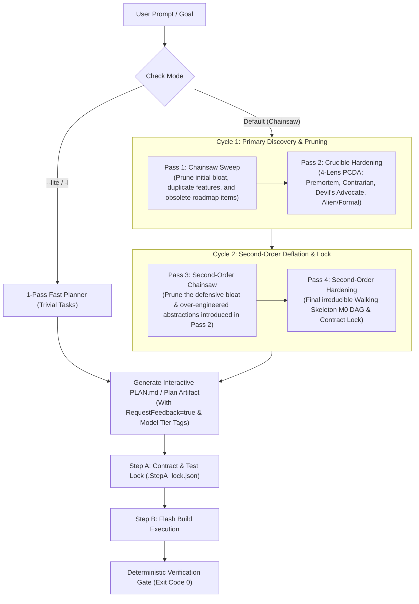

# 🪚 Universal Dual-Cycle Chainsaw Planning Engine (`/plan`)

> **Unified Planning Standard**: Dual-Cycle Chainsaw Crucible Architecture (2x Prune $\to$ 2x Harden).  
> **Default Stance**: **Dual-Cycle 4-Pass Chainsaw** (Pass 1 Chainsaw $\to$ Pass 2 Hardening $\to$ Pass 3 Chainsaw $\to$ Pass 4 Hardening $\to$ Interactive Plan Artifact).  
> **Fast Fallback**: `--lite` (or `-l`) for trivial 1-pass task lists.  
> **Model Tiering**: Tier 1 (Gemini 4 Argon / Claude Opus) for Step A Contract Locking $\to$ Tier 2 (Gemini 3.8 Flash High) for Step B Build Execution.  
> **Tooling Bridge**: Directly integrates with `tools/plan_manager.py`, `/step-verify`, and `/task-finish`.

---

## 🧭 The Dual-Cycle 4-Pass Architecture

---

## ⚡ The 4-Pass Execution Protocol

### 🔁 Cycle 1: Primary Discovery & Pruning

#### Pass 1: The Primary Chainsaw Sweep
Before proposing any code or milestones, ruthlessly prune the problem space:
1. **Tool Overlap Audit**: What existing tools, APIs, or libraries make proposed components redundant? *(e.g. ConnectRPC eliminates custom HTTP bridges; Pydantic v2 eliminates custom validation logic).*
2. **Feature Slicing**: What features can be completely discarded without violating the core intent ($I^*$)?
3. **The Second-System Defense**: Where are we over-engineering from past experience?
*Output*: **The Primary Graveyard** (explicit list of discarded mechanisms).

#### Pass 2: The Primary Crucible Hardening
Takes the pruned skeleton from Pass 1 and subjects it to adversarial stress:
1. **Dual-Persona Formulation**:
   - Persona A: 100% Offline / Standalone (instant boot, zero network, zero blocking).
   - Persona B: First-Class AI-in-the-Loop (deep telemetry, autonomous dispatch).
2. **4-Lens PCDA Matrix**:
   - `[P] Premortem`: What catastrophic failure occurs 6 months post-launch?
   - `[C] Contrarian`: "Where I Disagree" with default architectural assumptions.
   - `[D] Devil's Advocate`: Concurrency deadlocks, Windows file locks, handle leaks.
   - `[A] Alien/Formal`: Minimal formal state machine ($S = \langle P, T, C \rangle$).
*Output*: Hardened preliminary architecture with defensive mechanisms.

---

### 🔁 Cycle 2: Second-Order Deflation & Lock

#### Pass 3: The Second-Order Chainsaw Sweep
*The critical missing link in modern AI planning*: Hardening in Pass 2 almost always introduces **accidental complexity** (excessive wrapper layers, redundant fallback handlers, overly complex state machines). Pass 3 takes the chainsaw directly to that defensive machinery:
1. **Abstraction Deflation**: "Can an invariant guarantee make this entire error-handling layer unnecessary?"
2. **State Minimization**: "Can we collapse 5 state variables into 2?"
3. **Zero-Token Verification**: "Does this secondary design cause hidden polling or token churn?"
*Output*: **The Deflation Ledger** (pruning the complexity that Pass 2 introduced).

#### Pass 4: The Second-Order Hardening & Contract Lock
Takes the deflated, irreducible architecture and locks it into an executable plan:
1. **Walking Skeleton M0 DAG**:
   - Kahn's topological sort ensuring Milestone M0 is a minimal end-to-end working skeleton before any feature expansion.
2. **Contract Boundaries**:
   - Exact signatures for Step A (Tier 1 Argon / Opus) locking.
3. **Deterministic Verification Gates**:
   - Binary pass/fail test commands (Exit Code 0 only, zero LLM self-grading).
*Output*: The final, unbreakable plan structure.

---

## 🎛️ Command Modifiers

| Flag | Meaning | When to Use |
| :--- | :--- | :--- |
| *(default)* | **Dual-Cycle 4-Pass Chainsaw** | Standard engineering, refactors, new features, tool integrations. |
| `--lite`, `-l` | **1-Pass Lite Plan** | Trivial tasks (renaming symbols, adding a single CSS class, quick doc fixes). |
| `--single`, `-1` | **Single-Cycle (2-Pass)** | Intermediate tasks where 1 pass of prune + harden is sufficient. |
| `--argon` | **Tier 1 Contract Lock** | Enforces Gemini 4 Argon / Claude Opus for Step A specification contracts. |
| `--flash` | **All-Flash Execution** | Uses Gemini 3.8 Flash High for all planning passes and build steps. |

---

## 📝 Canonical Output Format

Every `/plan` outputs an interactive artifact written to `<appDataDir>\brain\<conversation-id>\` (and synced to `PLAN.md`):

1. **Core Intent vs. Mechanism**: Clear separation of $I^*$ and $M$.
2. **The Chainsaw Graveyard (Cycles 1 & 2)**: What was cut from the original idea, and what defensive bloat was deflated in Pass 3.
3. **Walking Skeleton Milestone DAG**:
   - Milestone M0: Minimal End-to-End Skeleton (The Walking Skeleton)
   - Milestone M1: Core Feature Implementation
   - Milestone M2: Edge Cases & Self-Healing
   - Milestone M3: Verification & Polish
4. **Phase Checklist**: `[ ]` tasks ready for 1-command advancement via `python tools/plan_manager.py check <phase>`.
5. **Interactive Feedback Prompt**: Enables 1-click "Proceed" execution.
