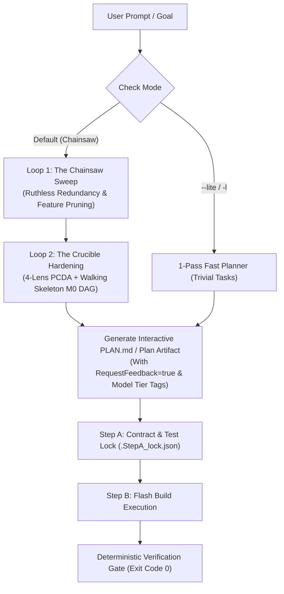

# 🪚 Universal 2-Loop Chainsaw Planning Engine (`/plan`)

> **Unified Planning Standard**: Merges classic `/plan` simplicity with `/crucible-plan` adversarial rigor.  
> **Default Stance**: **Chainsaw Mode** (Loop 1 Pruning $\to$ Loop 2 Hardening $\to$ Interactive Plan Artifact).  
> **Fast Fallback**: `--lite` (or `-l`) for trivial 1-pass task lists.  
> **Model Tiering**: Tier 1 (Gemini 4 Argon / Claude Opus) for Step A Contract Locking $\to$ Tier 2 (Gemini 3.8 Flash High) for Step B Build Execution.  
> **Tooling Bridge**: Directly integrates with `tools/plan_manager.py`, `/step-verify`, and `/task-finish`.

---

## 🧭 The 2-Loop Chainsaw Architecture

---

## ⚡ Execution Protocol

### Loop 1: The Chainsaw Sweep (Ruthless Pruning)
Before proposing any code or milestones, the agent asks:
1. **What existing tools, APIs, or libraries make proposed parts redundant?**
   *(e.g., Don't build a custom socket server if ConnectRPC or WebSocket already exists; don't write a JSON parser if Pydantic v2 is already present).*
2. **What can be cut without harming the irreducible core intent ($I^*$)?**
3. **Where are we falling into "the second system effect" (adding unnecessary complexity)?**
*Output of Loop 1*: The Graveyard of Bloat (explicitly listing what is cut and why).

### Loop 2: The Crucible Hardening (Dual-Persona & 4-Lens PCDA)
Takes the pruned skeleton and applies:
1. **Dual-Persona Stress Test**:
   - Extreme A: 100% Offline / Standalone (zero network, zero daemon, instant boot).
   - Extreme B: First-Class AI-in-the-Loop (rich telemetry, autonomous agent orchestration).
2. **4-Lens Adversarial Matrix**:
   - `[P] Premortem`: How does this fail 6 months from now?
   - `[C] Contrarian`: "Where I Disagree" with naive implementation assumptions.
   - `[D] Devil's Advocate`: Windows file locks, handle leaks, concurrency races.
   - `[A] Alien/Formal`: Minimal state machine algebra ($S = \langle P, T, C \rangle$).
3. **Walking Skeleton M0 DAG**:
   - Kahn's topological sort ensuring Milestone M0 is a minimal end-to-end working skeleton before any feature expansion.

---

## 🎛️ Command Modifiers

| Flag | Meaning | When to Use |
| :--- | :--- | :--- |
| *(default)* | **Full 2-Loop Chainsaw** | Standard engineering, refactors, new features, tool integrations. |
| `--lite`, `-l` | **1-Pass Lite Plan** | Trivial tasks (renaming symbols, adding a single CSS class, quick doc fixes). |
| `--argon` | **Tier 1 Contract Lock** | Enforces Gemini 4 Argon / Claude Opus for Step A specification contracts. |
| `--flash` | **All-Flash Execution** | Uses Gemini 3.8 Flash High for both planning loops and build steps. |

---

## 📝 Canonical Output Format

Every `/plan` outputs an interactive artifact written to `<appDataDir>\brain\<conversation-id>\` (and synced to `PLAN.md`):

1. **Core Intent vs. Mechanism**: Clear separation of $I^*$ and $M$.
2. **The Chainsaw Graveyard**: Bullet list of redundancies eliminated.
3. **Walking Skeleton Milestone DAG**:
   - Milestone M0: Minimal End-to-End Skeleton
   - Milestone M1: Core Feature Implementation
   - Milestone M2: Edge Cases & Self-Healing
   - Milestone M3: Verification & Polish
4. **Phase Checklist**: `[ ]` tasks ready for 1-command advancement via `python tools/plan_manager.py check <phase>`.
5. **Interactive Feedback Prompt**: Enables 1-click "Proceed" execution.
