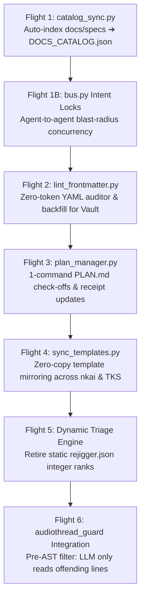

# Implementation Plan: Zero-Token Mechanical Automation Suite (Flights 1–7)

> **Task Name:** `zero-token-automation-suite`  
> **Target Pipeline:** `TARGET: TOOLING_HARNESS`  
> **Active Milestone:** `TKS v0.4.1 / Ecosystem Tooling Hardening`  
> **Recommended Model Tier:** `Tier 2 (Gemini 3.8 Flash High)`  
> **Status:** `IN_PROGRESS` 🔨  
> **Progress:** `4/7 Flights Completed (57%)`  

---

## 🎯 Executive Summary & Token Churn Rationale

When AI agents perform clerk-like tasks—re-indexing large JSON files, checking off markdown phase boxes, inspecting hundreds of files for YAML headers, or synchronizing identical templates across three repositories—they burn tens of thousands of expensive LLM tokens on rote mechanical operations.

This milestone constructs **The Zero-Token Mechanical Automation Suite**: seven targeted Python CLI tools that offload mechanical formatting, validation, and synchronization to sub-5ms native scripts, eliminating **~500,000+ tokens of monthly churn** across New Klang City and the Cosmic Codex.

---

## 🛫 The 7 Sequential Flights & QA Acceptance Criteria

### Flight 1: `tools/catalog_sync.py` (Docs Catalog & System Map Auto-Synchronizer)
- **Problem**: Updating `docs/DOCS_CATALOG.json` (451 lines) and `docs/SYSTEM_MAP.md` burns ~40k tokens per doc pass manually formatting JSON dictionaries.
- **Implementation**:
  - Author `tools/catalog_sync.py`.
  - Walks `docs/specs/`, `tools/`, `Source/dsp/`, parsing YAML frontmatter or `# Title` + docstring.
  - Automatically regenerates or validates `docs/DOCS_CATALOG.json` and `docs/SYSTEM_MAP.md`.
  - CLI flags: `--check` (CI exit code 1 if out-of-date) and `--fix` (regenerates cleanly).
- **QA & Invariants**:
  - Universal UTF-8 Console Streams and explicit `encoding='utf-8'` on all file I/O.
  - Schema parity: generated JSON must validate against `DOCS_CATALOG.json` structure without losing custom category groupings.
  - Unit test: `tools/tests/test_catalog_sync.py` (asserts roundtrip, detection of uncataloged specs, `--check` exit codes).
- **Tasks**:
  - [x] Author `tools/catalog_sync.py` with AST / regex extraction.
  - [x] Author unit test `tools/tests/test_catalog_sync.py`.
  - [x] Validate against all 28 existing specs in `docs/specs/`.

---

### Flight 1B: `tools/bus.py` (Intent Locks & Blast-Radius Concurrency Telemetry)
- **Problem**: Human user acts as a manual message broker reassuring agents ("they're doing X, which won't impact Y, proceed"). Uncoordinated multi-agent filesystem writes risk race conditions.
- **Implementation**:
  - In `tools/bus.py`, add `type: INTENT_LOCK` and subcommands:
    - `lock --scope <paths> --activity "<desc>" [--ttl <minutes>]`: writes an ephemeral lock file to `Dispatches/Locks/<pillar>_lock.json` or `.md`.
    - `unlock`: clears active lock for the host pillar.
    - `locks`: lists active peer locks, filtering out expired TTLs.
    - `check-scope <paths>`: checks if target paths intersect with any active peer locks.
  - Exclude lock files from human unread chat footers (`type != DISPATCH`).
- **QA & Invariants**:
  - Zero-token silent operation: returns exit code 0 when scope is clear.
  - Auto-expiring TTL (default 30 min) protects against deadlocks if an agent session crashes or `/clear`s.
  - Unit test: `tools/tests/test_bus_locks.py`.
- **Tasks**:
  - [x] Implement lock/unlock/locks/check-scope subcommands in `tools/bus.py`.
  - [x] Author unit test `tools/tests/test_bus_locks.py`.
  - [x] Wire scope collision check into `tools/state_manager.py`.

---

### Flight 2: `tools/lint_frontmatter.py` (Universal Vault Frontmatter Auditor & Fixer)
- **Problem**: Codex mandate requires all Markdown files in the vault (`Docs/`, `Lore/`, `Inbox/`, `Research/`) to maintain clean YAML frontmatter. Having an LLM read and fix 600+ notes burns enormous context.
- **Implementation**:
  - Author `tools/lint_frontmatter.py`.
  - Scans specified directory (`--dir <path>`) for `.md` files missing valid frontmatter (`id`/`title`, `date`, `tags`, `status`).
  - `--fix` mode: automatically backfills missing keys (derives title from first `# H1` or filename stem, date from file creation/mtime, tags defaults to `[untriaged]`).
- **QA & Invariants**:
  - Safe editing: never truncate or mutate note body content.
  - UTF-8 safe with `errors='replace'` on untrusted external notes.
  - Unit test: `tools/tests/test_lint_frontmatter.py` (tests detection, safe backfilling, and idempotency).
- **Tasks**:
  - [x] Author `tools/lint_frontmatter.py`.
  - [x] Author unit test `tools/tests/test_lint_frontmatter.py`.
  - [x] Run dry-run audit across `TheKlangVault/` and assert 0 data loss.

---

### Flight 3: `tools/plan_manager.py` (1-Command Phase Advancement & Telemetry)
- **Problem**: Toggling `- [ ] Phase N:` $\rightarrow$ `- [x] Phase N:` and updating `factory_receipt.md` or `tooling_receipt.md` burns ~3,500 tokens of file reading and `replace_file_content` per phase.
- **Implementation**:
  - Author `tools/plan_manager.py`.
  - CLI subcommands:
    - `status`: outputs current plan title, active phase, and completion percentage.
    - `check <phase_num>`: flips `- [ ] Phase N` to `- [x] Phase N` and updates header progress string (`Progress: N/M Flights Completed (X%)`).
    - `advance`: checks off current phase and transitions `factory_receipt.md` to `## Status: BUILDING 🔨 (Phase N+1)`.
- **QA & Invariants**:
  - Must handle nested markdown checklists without false positives.
  - Zero regex clobbering; retains all phase notes and code snippets verbatim.
  - Unit test: `tools/tests/test_plan_manager.py`.
- **Tasks**:
  - [x] Author `tools/plan_manager.py`.
  - [x] Author unit test `tools/tests/test_plan_manager.py`.
  - [x] Verify phase advance against fixture plans.

---

### Flight 4: `tools/sync_templates.py` (Multi-Repo Template & Asset Synchronizer)
- **Problem**: UI updates require the LLM to manually copy `master_template.html`, `sidecar.css`, and `sidecar.js` across `nkai/core/`, `TheKlangSuite/.agents/sidecar/`, and `nkai/bundle/templates/` (~20,000 tokens).
- **Implementation**:
  - Author `tools/sync_templates.py`.
  - Sets `nkai/core/` as canonical source.
  - CLI subcommands:
    - `check`: computes SHA-256 hashes across all target locations and reports drift.
    - `sync`: copies master templates to `TheKlangSuite` and `bundle/` in <5ms.
- **QA & Invariants**:
  - Checks junction health before copying.
  - Never overwrites if destination is uncommitted/dirty without `--force`.
  - Unit test: `tools/tests/test_sync_templates.py`.
- **Tasks**:
  - [ ] Author `tools/sync_templates.py`.
  - [ ] Author unit test `tools/tests/test_sync_templates.py`.
  - [ ] Assert 100% hash parity across all template mirrors.

---

### Flight 5: Dynamic Triage Engine & `rejigger.json` Retirement
- **Problem**: Maintaining a static array of 37 integer-ranked cards in `rejigger.json` is an $O(N)$ anti-pattern that burns ~25,000 tokens per triage re-sort.
- **Implementation**:
  - Refactor `tools/check_mail.py` to sort cards dynamically at render time by `(priority_weight, date, status)` rather than relying on hardcoded static rank indices.
  - Retire `rejigger.json` and `overflow.json` as active sources of truth; preserve historical angle bullets in `mail_queue.json`.
  - Add 1-command card archival: `python tools/check_mail.py --archive-card <id>` (moves note to `Archive/` and marks queue status in <5ms).
- **QA & Invariants**:
  - Zero loss of human notes or existing triaged status badges.
  - Preserves offline board rendering without regressions.
  - Unit test: `tools/tests/test_dynamic_triage.py`.
- **Tasks**:
  - [ ] Update `tools/check_mail.py` to sort dynamically on priority/status.
  - [ ] Add atomic `--archive-card` CLI option.
  - [ ] Author unit test `tools/tests/test_dynamic_triage.py`.

---

### Flight 6: `audiothread-guard` Pre-AST Scan Integration
- **Problem**: During DSP verification, agents sometimes read 1,000+ lines of `.cpp` files to verify real-time safety, burning tens of thousands of tokens.
- **Implementation**:
  - Update `tools/audiothread_guard.py` with `--terse` / `--token-shield` output mode:
    - If clean: emits single line: `✅ Audio-Thread Safety: 0 violations across N files.`
    - If violations found: emits ONLY the file path, line number, offending token, and snippet (<100 tokens total).
  - Update `.agents/skills/audiothread-guard/SKILL.md` to enforce the Pre-AST filter rule: agents never inspect full source files for safety; they run the CLI and review only the filtered violation lines.
- **QA & Invariants**:
  - Must catch all mandatory invariants: `new`, `malloc`, `std::mutex`, `juce::CriticalSection`, `DBG()`, `std::cout`, CRT transcendentals.
  - Zero false positives on pre-allocated containers or audio thread bypass paths.
  - Unit test: `tools/tests/test_audiothread_guard.py`.
- **Tasks**:
  - [ ] Add `--terse` output mode to `tools/audiothread_guard.py`.
  - [ ] Update `.agents/skills/audiothread-guard/SKILL.md`.
  - [ ] Validate against intentional failure fixture.

---

## 🛡️ Verification & Regression Gauntlet

At the conclusion of each flight:
1. `python -m unittest discover tools/tests/` (assert 100% pass across all test suites).
2. `python tools/verify_utf8.py --strict` (assert 100% compliance across all new/modified scripts).
3. `python tools/state_manager.py sync` (synchronize `ACTIVE_CONTEXT.md` with zero drift).
4. Conventional git commit per flight.

---

## 🛑 Rollback & Safety Invariants

- All newly authored tools are non-destructive by default (`--dry-run` supported on all mutating commands).
- Git branches and working trees remain clean at each flight checkpoint.
- If any tool fails validation, `git checkout` reverts the flight without affecting native audio DSP or plugin builds.
