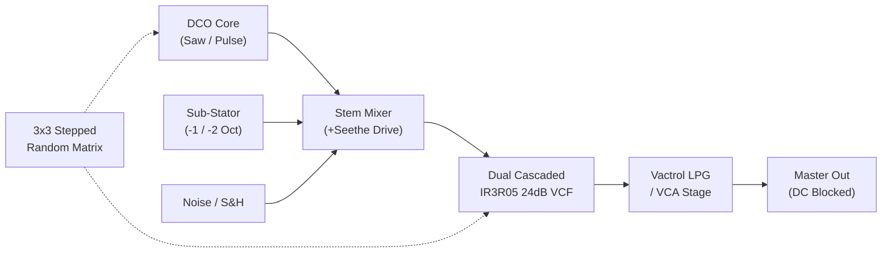
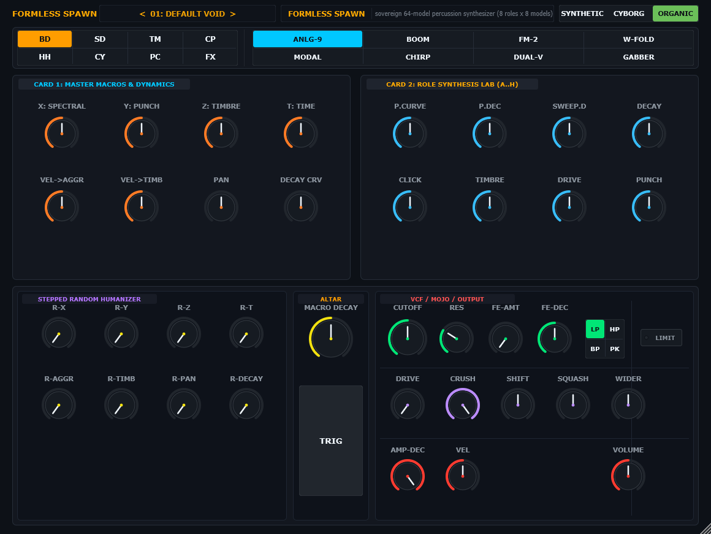
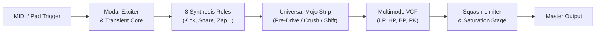
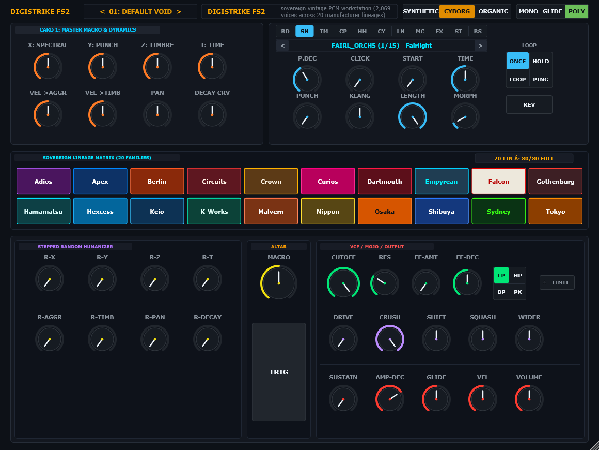
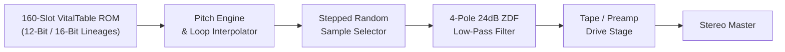
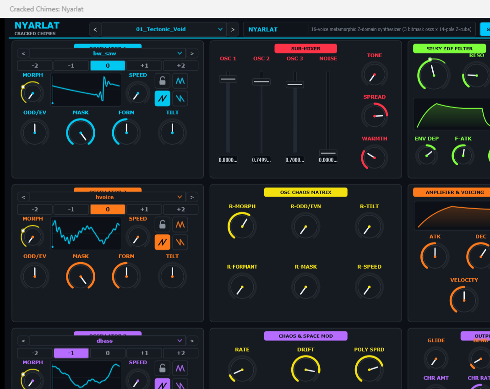
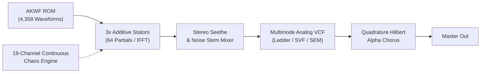

# The Klang Suite

> **Sovereign Synthesizer Fleet & Sound Lab**  
> Formats: **VST3** · **AU** (macOS Universal arm64/x86_64) · **Standalone** (macOS, Linux, Windows)  
> Engine: C++20 / JUCE 9.0.3 · 64-bit float audio path · Zero audio-thread allocation · Level 5 `pluginval` verified

---

## ⚡ The Cracked Chimes Fleet Overview

The Klang Suite is a collection of four specialized software synthesizers and percussion engines built for extreme sound design, tracker production, and hardware-grade stability. Every instrument shares the **Cracked Chimes** universal chassis: host-agnostic JSON preset discovery, lock-free audio thread watchdogging (`DuckGate`), Smart Dice log-domain mutation, and tripartite physical modeling.

```
┌─────────────────────────────────────────────────────────────────────────────┐
│                            CRACKED CHIMES FLEET                             │
├───────────────────┬───────────────────┬───────────────────┬─────────────────┤
│      HASTUR       │  FORMLESS SPAWN   │  DIGISTRIKE FS2   │     NYARLAT     │
│  Metamorphic Sub  │  Macro Percussion │   Vintage PCM     │  Additive Chaos │
│  Dual IR3R05 VCF  │  8-Voice Modals   │  160-Slot ROM     │  3x IFFT Banks  │
└───────────────────┴───────────────────┴───────────────────┴─────────────────┘
```

---

## 1. Hastur (v1.3.0) — Metamorphic Sub-Bass Synthesizer


### The Pipe (Signal Flow)
Monophonic sub-bass instrument engineered around Roland DCO pulse-clocking and dual cascaded IR3R05 24 dB/oct state-variable low-pass filters with monolithic 2x oversampling on saturation stages.



### Topo-Map & Front Panel Layout
* **Bay 1 (DCO Core)**: Dual-polarity DCO with octave detents, variable waveshape selection (saw, pulse, inverted pulse, parabolic sub), and variable all-pass phase dispersion.
* **Bay 2 (Stem Mixer & Cross-Mod)**: Independent gain faders for Core, Sub, and Noise stems. Seethe control drives pre-filter saturation. Secondary FM and AM depth controls cross-modulate the DCO against the sub-oscillator.
* **Bay 3 (Dual IR3R05 VCF)**: Dual series 4-pole filters featuring bipolar cutoff warp, resonance damping compensation, laser comb recirculation, and anti-phase stereo cutoff offset.
* **Triad Lifeform Switch**:
  * `SYNTHETIC`: Pure integer harmonics and clean virtual analog response.
  * `CYBORG`: 6-bit amplitude quantization with dual-channel rail foldback.
  * `ORGANIC`: Optical vactrol lag with asymmetric tube saturation.

### 60-Second Sound Drop (Fast Start)
1. Set **DCO WAVE** to Pulse 50%, **SUB OCT** to `-1 Oct`.
2. Set **CUTOFF** to 180 Hz, **RESO** to 0.45, **VCF WARP** to `+12%`.
3. Set **CODY ATTACK** to 0 ms, **PUNCH** to 75%, **SUSTAIN** to 60%.
4. *Listening Check*: Low C1 yields an authoritative, phase-locked square sub with instantaneous acoustic punch and zero sub-bass mud.

### Acoustic Boundaries & Non-Goals
* **Non-goal**: Polyphonic pads, supersaw trance stacks, acoustic bass simulation.
* **When not to use**: Chordal progressions (Hastur is hard-wired strictly monophonic with high-priority note stealing).

---

## 2. Formless Spawn (v1.3.0) — Macro Percussion & Drum Workstation



### The Pipe (Signal Flow)
8-voice polyphonic modal percussion synthesizer combining non-linear physical excitation, transient modeling, and hardware-style dynamic clipping.



### Topo-Map & Front Panel Layout
* **Voice Navigator & Model Matrix**: 8 synthesis roles (Kick, Snare, Tom, HiHat, Cymbal, Perc, Zap, Sub) spanning 16 drum model algorithms.
* **4-Axis Macro Lab**:
  * `X (Spectral)`: Harmonic spread, sweep excursion, and modal frequency dispersion.
  * `Y (Punch)`: Transient attack spike, click snap, and initial membrane acceleration.
  * `Z (Timbre)`: Waveshaping foldback and nonlinear overtone density.
  * `T (Time)`: Pitch envelope discharge rate and body ring-down duration.
* **Universal Mojo Strip**: Dedicated pre-filter overdrive, sample-rate reduction (Crush), single-sideband frequency shifting, and ceiling limiter.
* **Performance Altar**: Central tactile trigger pad paired with macro decay for live auditioning.

### 60-Second Sound Drop (Fast Start)
1. Select **ROLE 1 (KICK)**, Model `01: Hard Core`.
2. Set **MACRO Y (PUNCH)** to 85%, **MACRO T (TIME)** to 250 ms.
3. Turn **PRE-DRIVE** to 30%, engage **SQUASH LIMITER**.
4. Strike the central **TACTILE TRIGGER PAD**.
5. *Listening Check*: A club kick drum with transient punch peaking at -0.1 dBFS without digital clipping.

### Acoustic Boundaries & Non-Goals
* **Non-goal**: Multi-gigabyte acoustic drum kit sampling, realistic orchestral cymbals.
* **When not to use**: Authentic acoustic jazz trap kit emulation.

---

## 3. DigiStrike FS2 (v1.2.0) — Sovereign Vintage PCM Workstation



### The Pipe (Signal Flow)
16-voice vintage PCM workstation with sample-rate tracking, hardware loop points, and non-interpolated vintage playback options.



### Topo-Map & Front Panel Layout
* **PCM Vault**: 160 factory PCM instruments across 20 vintage hardware lineages (Yamaha, Roland, E-mu, Korg, Ensoniq, Casio, Kawai).
* **Clock & Pitch Engine**: Authentic hardware clock dividing, multi-segment loop points, and selectable linear vs non-interpolated sample playback.
* **Voice Dynamics**: 16 polyphonic voices with per-voice resonant low-pass filter, pitch envelope attack detents, and velocity timbre coupling.
* **Sample S&H Modulator**: Stepped random sample selection on every note-on for generative organic variety.

### 60-Second Sound Drop (Fast Start)
1. Select **SLOT 014: Slap Bass 1**.
2. Set **FILTER CUTOFF** to 2.2 kHz, **RESONANCE** to 0.30.
3. Set **PITCH ENV DEPTH** to `+7 st`, **DECAY** to 45 ms.
4. Play velocity 127 octave pops on your MIDI keyboard.
5. *Listening Check*: Authentic 1989 workstation slap bass with snappy transient bite and zero aliasing jitter.

### Acoustic Boundaries & Non-Goals
* **Non-goal**: 100GB orchestral sample streaming, round-robin multi-mic multisampling.
* **When not to use**: Gigabyte-scale piano or symphonic acoustic libraries.

---

## 4. Nyarlat (v1.0.0) — Flagship Additive Chaos Synthesizer



### The Pipe (Signal Flow)
16-voice additive wavetable synthesizer utilizing 3 bitmask wavetable oscillators with 64 dynamic partials synthesized in real time via real IFFT (`juce::dsp::FFT(9)`).



### Topo-Map & Front Panel Layout
* **3x Additive Stator Banks**: Full spectral morphing, odd/even partial balance, spectral tilt, vowel formants, bitmask decimation, and stator speed control.
* **Shortest-Arc Phase Interpolation**: Full AKWF ROM spectral seed morphing across 4,358 single-cycle waveforms with smooth morphing and zero phase artifacts.
* **Linear M/S Stereo Spatialization**: Thue-Morse sign distribution guarantees 100% phase cancellation-free mono compatibility.
* **19-Channel Chaos Matrix**: Multi-rate smooth and stepped stochastic modulation routable to all 18 oscillator timbral targets.
* **Hilbert Quadrature Alpha Chorus**: Continuous zero-latency dual 90-degree all-pass network for wide, smear-free chorus modulation.

### 60-Second Sound Drop (Fast Start)
1. Set **OSC 1 BANK** to `01 - Tectonic Pads`, Morph to 45%.
2. Set **FILTER CUTOFF** to 800 Hz, **ENV DEPTH** to `+50%`.
3. Advance **ALPHA CHORUS** to 40%, **CHR RATE** to 1.2 Hz.
4. Hold a minor 9th chord across octaves 3 and 4.
5. *Listening Check*: Dense, shifting additive textures with zero static phasing and massive stereo spread.

### Acoustic Boundaries & Non-Goals
* **Non-goal**: Subtractive monosynth emulation, FM metallic percussion.
* **When not to use**: Raw analog monosynth leads requiring zero-latency analog feedback loops.

---

## 5. Universal Topo-Map & Panel Layout

Every instrument in The Klang Suite conforms to the **Cracked Chimes 16-Control Canon**:

* **Header Title Block**: Positioned at `(14, 4, 140, 36)`. Clicking triggers the in-editor **About Dialog** displaying versioning, engine details, and attributions.
* **Stepper Audition Bar**: Positioned at `(162, 8, 288, 28)` (or `(162, 8, 220, 28)` on drum consoles). Step through patches with `[ < ]` and `[ > ]`, or click patch name to launch the **Preset Browser Modal**.
* **Preset Browser Overlay**: 680×440 modal card featuring:
  * Instant search filtering across patch titles and categories.
  * Zero-allocation `ListBoxModel` flyweight display.
  * Section Locks bitmask (`LockOscCore`, `LockFilterVCF`, `LockEnvelopes`, `LockMasterFX`, `LockModMatrix`).
  * Smart Dice randomizer with 16-step undo ring buffer.
* **Live Dynamic Arc Halos**: Real-time visualization of envelope sweeps, LFO modulations, and chaos excursions rendered directly around parameter dials.

---

## 6. The Parameter Ledger

A representative cross-section of primary parameters across the fleet:

| Parameter | Range | Default | Step Resolution | Unit | Curve Law | Modulation Destination / Target |
| :--- | :--- | :--- | :--- | :--- | :--- | :--- |
| **DCO Cutoff (Hastur)** | 20.0 – 20000.0 | 440.0 | 0.1 | Hz | Logarithmic | Dual IR3R05 Filter Core |
| **VCF Resonance (Hastur)** | 0.0 – 1.0 | 0.15 | 0.01 | Norm | Linear | IR3R05 Q Feedback Path |
| **Macro Punch (Formless)** | 0.0 – 1.0 | 0.50 | 0.01 | % | Linear | Transient Acceleration Core |
| **Macro Time (Formless)** | 10.0 – 2000.0 | 350.0 | 1.0 | ms | Exponential | Pitch & Body Decay Envelope |
| **Filter Cutoff (DigiStrike)** | 100.0 – 16000.0 | 4000.0 | 1.0 | Hz | Logarithmic | 4-Pole ZDF Low-Pass Filter |
| **Pitch Env Depth (DigiStrike)** | -24.0 – +24.0 | 0.0 | 1.0 | semitones | Linear | Vintage PCM Sample Rate Clock |
| **Stator Morph (Nyarlat)** | 0.0 – 1.0 | 0.0 | 0.001 | Norm | Linear | AKWF Spectral Waveform Seed |
| **Alpha Chorus (Nyarlat)** | 0.0 – 1.0 | 0.0 | 0.01 | % | Linear | Hilbert Polyphase Matrix |
| **Chaos Rate (Nyarlat)** | 0.01 – 20.0 | 1.0 | 0.01 | Hz | Logarithmic | 19-Channel Stochastic Matrix |

---

## 7. Sound Design Cookbook (Patch Recipes)

### Patch 01: The Floor Melter (Hastur Reese Sub)
1. Initialize Hastur to Init Patch.
2. Bay 1: Select DCO Wave `Saw 1`, set **SLOP** to 25%.
3. Bay 2: Turn **SUB LEVEL** to `+3 dB`, engage **SUB OCT** at `-2 Oct`.
4. Bay 5: Set **CUTOFF** to 140 Hz, **WARP** to `+18%`, **COMB** to 30%.
5. *Result*: Massive moving low-end sub that remains phase-centered while harmonics breathe.

### Patch 02: Industrial Piston Kick (Formless Spawn)
1. Select Role `Kick`, Model `02: Nuclear Waste`.
2. Turn **PRE-DRIVE** to 45%, set **CRUSH** to 12-bit.
3. Set **MACRO Y (PUNCH)** to 90%, **MACRO Z (TIMBRE)** to 60%.
4. Engage **SQUASH LIMITER** with threshold at -6 dB.
5. *Result*: Distorted, heavyweight industrial techno kick with aggressive transient snap.

### Patch 03: 1991 Tracker Rave Organ (DigiStrike FS2)
1. Select PCM Slot `042: Perc Organ`.
2. Set **FILTER CUTOFF** to 3.5 kHz, **RESONANCE** to 0.40.
3. Set **AMP ATTACK** to 0 ms, **DECAY** to 450 ms, **SUSTAIN** to 0%.
4. Set **DRIVE** to 20% for analog console preamp coloration.
5. *Result*: Classic early 90s warehouse rave organ chord stab with authentic vintage DAC aliasing.

### Patch 04: Dimensional Choral Drone (Nyarlat)
1. Osc 1: Bank `03 - Choral & Morphing Strings`, Morph at 65%.
2. Osc 2: Bank `01 - Tectonic Pads`, Tune `+7 st`, Morph at 30%.
3. Filter: Select `SEM 12 BP`, Cutoff at 650 Hz, Resonance at 0.55.
4. Master: Engage **ALPHA CHORUS** at 50%, **WIDTH** at 85%.
5. Mod Matrix: Route **CHAOS 1** to Osc 1 Tilt (`+30%`) and **CHAOS 2** to Filter Cutoff (`+25%`).
6. *Result*: Constantly evolving, vocal-like harmonic pad with zero repetitive loops.

---

## 8. The Matrix & Audio Diagnostic Troubleshooting

### MIDI CC Implementation Matrix
| CC # | Parameter Destination | Function |
| :---: | :--- | :--- |
| **1** | Modulation Wheel | Primary Modulation Depth / MPE Slide |
| **7** | Master Volume | Master Output Level |
| **11** | Expression | VCA Level Scaling |
| **64** | Sustain Pedal | Envelope Hold / Damper |
| **71** | Filter Resonance | VCF Q Bandwidth |
| **74** | Filter Cutoff / MPE Timbre | High-Resolution VCF Cutoff Excursion |

### Audio Diagnostic Matrix
| Symptom / Audio Fault | Root Cause | Immediate Panel Resolution |
| :--- | :--- | :--- |
| **Output drops to complete silence** | Audio thread watchdog tripped by unstable parameter input or NaN | Toggle **Panic / Flush** in header, or cycle patch via Stepper Audition Bar. |
| **Excessive DC offset / Sub rumble** | Filter self-oscillation combined with extreme low-frequency modulation | Engage **DC Blocker** (always active on final stage); reduce Filter Drive below 80%. |
| **Sudden harsh digital clipping** | Master gain staging exceeded (+18 dB digital ceiling) | Reduce **VOLUME** fader; on Formless Spawn, engage the dedicated **SQUASH LIMITER**. |
| **Patch randomizer produces silent patch** | Oscillator levels or VCF cutoff randomized to 0 | Press **[UNDO]** in Preset Browser overlay to restore previous patch state. |

---

## 9. Installation & Downloads

Official multi-platform release packages are hosted under **[GitHub Releases](https://github.com/codygratner/TheKlangSuite/releases)**.

| Target | Architecture | Package | Contents |
| :--- | :--- | :--- | :--- |
| **The Klang Suite v0.7.0** | Windows (x64) | `TheKlangSuite-v0.7.0-Windows.zip` | All 4 Plugins (VST3 + Standalone) |
| **The Klang Suite v0.7.0** | macOS (Universal) | `TheKlangSuite-v0.7.0-macOS.zip` | All 4 Plugins (AU + VST3 + Standalone) |
| **The Klang Suite v0.7.0** | Linux (x86_64) | `TheKlangSuite-v0.7.0-Linux.zip` | All 4 Plugins (VST3 + Standalone) |

Individual plugin downloads are also available for standalone deployment:
* **[Hastur v1.3.0](https://github.com/codygratner/TheKlangSuite/releases/tag/hastur-v1.3.0)**: Windows · macOS · Linux
* **[Formless Spawn v1.3.0](https://github.com/codygratner/TheKlangSuite/releases/tag/formless_spawn-v1.3.0)**: Windows · macOS · Linux
* **[DigiStrike FS2 v1.2.0](https://github.com/codygratner/TheKlangSuite/releases/tag/digistrike_fs2-v1.2.0)**: Windows · macOS · Linux
* **[Nyarlat v1.0.0](https://github.com/codygratner/TheKlangSuite/releases/tag/nyarlat-v1.0.0)**: Windows · macOS · Linux

### Installation Directories

#### macOS
* **VST3**: `/Library/Audio/Plug-Ins/VST3/`
* **AU**: `/Library/Audio/Plug-Ins/Components/`
* **Standalone**: `/Applications/`

#### Linux (x86_64)
* **VST3**: `~/.vst3/` or `/usr/lib/vst3/`

#### Windows (x64)
* **VST3**: `C:\Program Files\Common Files\VST3\`
* **Standalone**: Any local directory (e.g. `C:\Program Files\TheKlangSuite\`)

---

## 10. Building from Source

### Prerequisites
* CMake 3.22+
* C++20 compliant compiler (MSVC 2022, Apple Clang 14+, GCC 11+)
* Git

```bash
# 1. Clone repository
git clone --recurse-submodules https://github.com/codygratner/TheKlangSuite.git
cd TheKlangSuite

# 2. Clone JUCE 9.0.3
git clone --depth 1 --branch 9.0.3 https://github.com/juce-framework/JUCE.git JUCE

# 3. Configure & Compile Full Fleet (Release)
cmake -B build -DCMAKE_BUILD_TYPE=Release
cmake --build build --config Release --parallel

# 4. Run 82 DSP Verification Suites
./build/Release/dsp_tests.exe    # Windows
./build/dsp_tests                # Linux / macOS
```

---

## 11. License

Copyright © 2026 Cody Gratner / The Cult of Klang. All rights reserved.  
VST is a registered trademark of Steinberg Media Technologies GmbH.  
Audio Units is a registered trademark of Apple Inc.
