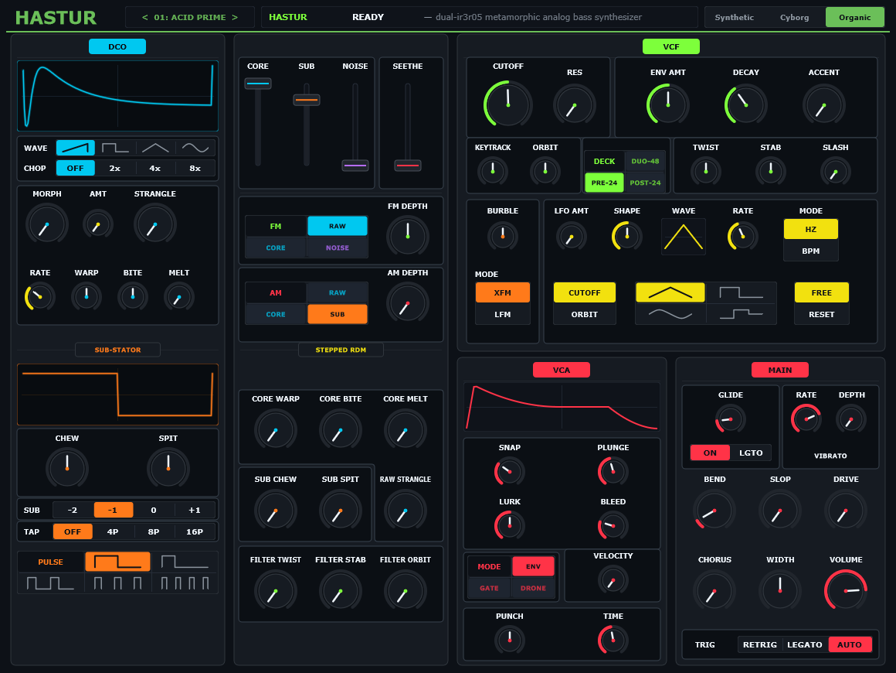

# Hastur

> **Dual-IR3R05 Sub-Bass Synthesizer**  
> Formats: **VST3** · **AU** (macOS) · **Standalone** (macOS, Linux, Windows)  
> Architecture: C++20 / JUCE 9.0.3 · 64-bit float audio path



---

## 1. Instrument Architecture

Hastur is a bass synthesizer modeled around Roland DCO pulse-clocking and dual cascaded IR3R05 24 dB/oct state-variable low-pass filters. The audio path maintains continuous DC normalization, 2x monolithic oversampling on non-linear stages, and zero audio-thread memory allocation.

```
[ DCO Core ] ───────┐
[ Sub-Stator ] ─────┼──> [ Stem Mixer ] ──> [ Dual IR3R05 VCF ] ──> [ Vactrol LPG / VCA ] ──> [ Out ]
[ Noise / S&H ] ────┘          │                     ▲
                               ▼                     │
                        [ X-Mod (FM/AM) ] ───────────┘
```

---

## 2. Panel Topology

The console is organized into six functional bays:

* **Bay 1 — DCO Core**: Dual-polarity frequency control with octave detents, variable waveshape selection (sawtooth, pulse, inverted pulse, parabolic sub), and variable all-pass phase dispersion.
* **Bay 2 — Stem Mixer & Cross-Mod**: Independent linear gain faders for Core, Sub, and Noise stems. The Seethe control drives pre-filter saturation. Secondary FM and AM depth controls cross-modulate the DCO against the sub-oscillator.
* **Bay 3 — Envelopes & Dynamics**:
  * *Vortex Envelope*: 4-stage filter contour with dedicated curve scaling.
  * *CodyBass Envelope*: Instant-attack sub-bass profile with variable punch and sustain shelf.
  * *Vactrol LPG*: Optical low-pass gate model with selectable synthetic, cyborg, and organic decay profiles.
* **Bay 4 — Stepped Random Modulation**: 3x3 Cartesian modulation matrix addressing all-pass filter cutoff, filter bite, and harmonic drive across three discrete circuit stems (DCO, Sub, Filter).
* **Bay 5 — Dual IR3R05 VCF**: Dual 4-pole low-pass filters in series. Features bipolar cutoff warp, resonance damping compensation, laser comb recirculation, and anti-phase stereo cutoff offset.
* **Bay 6 — Master Section**: Master volume, variable pitch-bend range (+/-1..24 semitones), and dedicated audio panic flush.

---

## 3. Installation & Downloads

Pre-built binaries for macOS, Linux, and Windows are available under **[Releases](https://github.com/codygratner/TheKlangSuite/releases)**.

### macOS
* Requires macOS 11.0 or higher (Universal Apple Silicon / Intel).
* Run the `.pkg` installer or copy `Hastur.vst3` / `Hastur.component` to your plugin directory:
  * VST3: `/Library/Audio/Plug-Ins/VST3/`
  * AU: `/Library/Audio/Plug-Ins/Components/`

### Linux (x86_64)
* Extract `Hastur-*-Linux.zip`.
* Copy `Hastur.vst3` to `~/.vst3/` or `/usr/lib/vst3/`.

### Windows (x64)
* Extract `Hastur-*-Windows.zip`.
* Copy `Hastur.vst3` to `C:\Program Files\Common Files\VST3\`.

---

## 4. Building from Source

```bash
git clone --recurse-submodules https://github.com/codygratner/TheKlangSuite.git
cd TheKlangSuite
git clone --depth 1 --branch 9.0.3 https://github.com/juce-framework/JUCE.git JUCE
cmake -B build -DCMAKE_BUILD_TYPE=Release
cmake --build build --config Release --parallel --target Hastur_VST3 Hastur_Standalone
```
