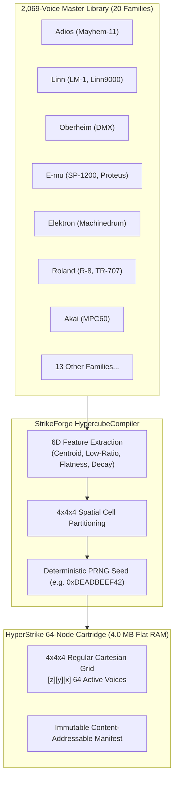

# Master Specification: `HyperStrike` (`MEGA-PERC-05D`)
## 4D Hypercube Percussion Synthesizer & Continuous Spatial Morphing Engine

**Document Status:** CANONICAL ECOSYSTEM SPECIFICATION 📜  
**Target Systems:** The Klang Suite (`TKS`), ToadTracker (`TT`), `StrikeForge` (`C:\Dev\StrikeForge`), The Tower DSP  
**Compliance Standard:** Universal 16-Control Card Architecture (`master_control_canon_and_template.md`)  
**IP Clearance Standard:** Clean-Room IP Scrubber Invariant (`tkdsp_16_control_canon.md`)  
**Sovereign Etymology:** *Hypercube* (4D Geometry / Spatial Lattice) + *DigiStrike* (Vintage Digital Percussion Lineage)  
**Tracker 2-Character ID:** `[HS]` (`0x78`)  
**C++ Namespace / Class:** `toad::HyperStrike` / `toad::HyperStrikeEngine`  
**Authors:** Antigravity x Cody G. (Klang Industries / ToadTracker Audio Division)  
**Date:** 2026-10-24  

---

## 1. Executive Summary & The Hypercube Paradigm

`HyperStrike` (`MEGA-PERC-05D` / `toad::HyperStrike`) establishes the definitive four-dimensional percussion instrument within The Klang Suite and ToadTracker. 

Rather than selecting discrete static drum samples from a menu, `HyperStrike` maps vintage digital percussion into a continuous **4D Hypercube ($W \times X \times Y \times Z$)**:
1. **$W$ (Temporal Traverse / Intra-Drum Scrub):** Sweeps along the temporal life-cycle of the drum hit, from initial sub-millisecond click/transient attack into the resonant acoustic shell decay and harmonic tail.
2. **$X$ (Role Spectrum Continuum):** Smoothly transitions across percussion roles:
   $$\text{Kick } (0.0) \;\longrightarrow\; \text{Tom } (0.33) \;\longrightarrow\; \text{Snare/Clap } (0.67) \;\longrightarrow\; \text{Hat/Cymbal } (1.0)$$
3. **$Y$ (Envelope Dynamics & Decay):** Modulates transient duration and energy decay:
   $$\text{Tight Laser Snap } (0.0) \;\longrightarrow\; \text{Punchy One-Shot } (0.33) \;\longrightarrow\; \text{Saturated Body } (0.67) \;\longrightarrow\; \text{Long Ring/Wash } (1.0)$$
4. **$Z$ (Harmonicity & Material Texture — Option B Canon):** Governs spectral density and modal coherence:
   $$\text{Pure Sine Tone } (0.0) \;\longrightarrow\; \text{Organic Acoustic Shell } (0.33) \;\longrightarrow\; \text{Saturated Drive } (0.67) \;\longrightarrow\; \text{Chaotic Noise/Glitch } (1.0)$$

---

## 2. The Cartridge Architecture & Preset Stability Invariant



### The Invariant Rules:
1. **Zero Preset Drift Guarantee:** Songs and tracker patterns store the 64-bit Cartridge Seed and the 64 Voice IDs. Adding 500 new drum kits to `StrikeForge` expands the candidate pool for future rolls but **never** shifts the coordinate space or voice assignments of existing songs.
2. **Deterministic Cartridge Reconstruction:** Given the identical seed and catalog, `HypercubeCompiler` guarantees 100% bit-for-bit identical node assignments across all platforms (Windows, macOS, Linux, Steam Deck).
3. **L3-Cache Friendly Footprint:** A 64-node cartridge with 16 wavetable frames $\times$ 2,048 samples $\times$ 16-bit PCM consumes exactly **4.00 MB of RAM**, fitting comfortably into modern CPU L3 caches for ultra-fast, lock-free real-time synthesis.

---

## 3. The Universal 16-Control Architecture (`MEGA-PERC-05D`)

```
Page 1A (Top Row / Left Hand: 4D Navigation & Time Engine)
[ Knob 1: PITCH ]          [ Knob 2: TRAVERSE / W ]   [ Knob 3: MORPH X (ROLE) ] [ Knob 4: MORPH Y (DECAY) ]
(Variable 555 Clock)       (Intra-Drum Temporal Pos)  (Kick ➔ Tom ➔ Snare ➔ Hat) (Tight Snap ➔ Long Ring)

Page 1B (Bottom Row / Right Hand: Texture, Filter, Heat & Destruction)
[ Knob 5: MORPH Z (TEXTURE)][ Knob 6: CUTOFF / VCF ]  [ Knob 7: DRIVE / HEAT ]   [ Knob 8: SRR / GLITCH ]
(Tone ➔ Shell ➔ Drive ➔ Noise) (Curtis CEM3320 24dB)  (Am6070 Saturation Drive)  (Decimator + [🎲 ROLL CART])
```

| Control | Parameter | Lineage | Range | Curve | Push Action | Description |
| :---: | :--- | :--- | :---: | :---: | :--- | :--- |
| **K01** | `PITCH / CLOCK` | Vintage HW | $8.0\text{ kHz} \dots 60.0\text{ kHz}$ | Profile D | *[Reset to 44.1kHz]* | Variable 555-timer pitch clock. |
| **K02** | `TRAVERSE / W` ⚡ | HyperStrike | $0.0 \dots 1.0$ | Linear | *[Freeze Temporal Phase]* | Intra-drum temporal scrub (attack $\to$ tail). |
| **K03** | `MORPH X (ROLE)` ⚡ | HyperStrike | $0.0 \dots 1.0$ | Linear | *[Snap to Nearest Column]* | Drum role continuum (`Kick` $\to$ `Tom` $\to$ `Snare` $\to$ `Hat`). |
| **K04** | `MORPH Y (DECAY)` ⚡| HyperStrike | $0.0 \dots 1.0$ | Linear | *[Snap to Nearest Row]* | Envelope dynamics axis (`Snap` $\to$ `Punch` $\to$ `Body` $\to$ `Wash`). |
| **K05** | `MORPH Z (TEXTURE)` ⚡| HyperStrike | $0.0 \dots 1.0$ | Linear | *[Invert Z Axis]* | Harmonicity & texture (`Tone` $\to$ `Shell` $\to$ `Drive` $\to$ `Noise`). |
| **K06** | `CUTOFF / VCF` | Curtis CEM3320 | $20\text{ Hz} \dots 20\text{ kHz}$ | Profile C | *[Bypass Filter]* | 24dB/oct Zero-Delay Feedback lowpass filter. |
| **K07** | `DRIVE / HEAT` | Am6070 DAC | $0.0\text{ dB} \dots +24.0\text{ dB}$ | Profile B | *[Compand Soft/Hard]* | Piecewise linear chord-ladder saturation drive. |
| **K08** | `SRR / GLITCH` | Machinedrum | $44.1\text{ kHz} \dots 1.0\text{ kHz}$ | Profile D | **`[🎲 ROLL CART]`** | Sample-rate reduction + Push to roll fresh cartridge! |

### Rear Sound Lab Controls (DIP Switches & Trimpots)
* **DIP 1 (`MUTE / SOLO`):** Instant voice isolate or mute.
* **DIP 2 (`GRID SNAP`):** Toggles continuous analog morphing vs discrete 4-step quantum stepping.
* **DIP 3 (`CART THEME`):** Cycles thematic pools (`[ ALL (2,069) | 80s Disco | Industrial Mayhem | Electro Lo-Fi ]`).
* **DIP 4 (`VOICE REVERSE`):** Inverts temporal scrub $W$ for backwards cymbal swell and laser sweeps.
* **TRIM 5 (`VCF RESONANCE`):** Curtis CEM3320 $Q$ ($0.5 \dots 25.0$).
* **TRIM 6 (`SATURATION TONE`):** Tilt EQ for Am6070 non-linear drive knee.
* **TRIM 7 (`ENVELOPE DECAY SLOPE`):** Exponential decay curvature ($0.5 \dots 4.0$).
* **TRIM 8 (`MASTER LEVEL`):** Output voice gain trim ($-48.0\text{ dB} \dots +6.0\text{ dB}$).

---

## 4. Trilinear Spatial Interpolation Mathematics

For any arbitrary continuous coordinate $(x, y, z) \in [0.0, 1.0]^3$, the engine evaluates the 8 bounding corners of the active unit cube in $\mathcal{O}(1)$ time:

$$\text{Grid Coordinates: } gx = x \cdot (N - 1), \quad gy = y \cdot (N - 1), \quad gz = z \cdot (N - 1) \quad (N = 4)$$
$$\text{Base Indices: } x_0 = \lfloor gx \rfloor, \quad y_0 = \lfloor gy \rfloor, \quad z_0 = \lfloor gz \rfloor$$
$$\text{Fractional Offsets: } u = gx - x_0, \quad v = gy - y_0, \quad w = gz - z_0 \quad \in [0, 1]$$

$$\begin{aligned}
w_{000} &= (1 - u)(1 - v)(1 - w) \\
w_{100} &= u(1 - v)(1 - w) \\
w_{010} &= (1 - u)v(1 - w) \\
w_{110} &= uv(1 - w) \\
w_{001} &= (1 - u)(1 - v)w \\
w_{101} &= u(1 - v)w \\
w_{011} &= (1 - u)vw \\
w_{111} &= uvw
\end{aligned}$$

$$\mathbf{Strict\;Invariant:}\quad \sum_{i=0}^1 \sum_{j=0}^1 \sum_{k=0}^1 w_{ijk} \equiv 1.000000 \quad \forall (x, y, z) \in [0.0, 1.0]^3$$

---

## 5. Milestone Verification Receipts

### Milestone M0: Feature Extraction & Cartridge Compiler (Completed 2026-10-24)
* **Tool Repository:** `C:\Dev\StrikeForge` (git commit `3fb4a0c`)
* **Test Suite:** `python -m unittest discover -s tests -v` passing **8/8 unit tests** in **0.052s**.
* **Catalog Telemetry:** Scanned **2,069 voices** across 20 manufacturer families (`C:\Dev\Samples\DigiStrike\catalog_features.json`).
* **Factory Cartridge:** Compiled `HyperStrike_Factory_01.json` (Seed: `0xDEADBEEF42`).
* **Audio Prototype:** Rendered 4D morphed hit `C:\Dev\Samples\DigiStrike\test_morphed_hit.wav` with 8-node trilinear weighting.
