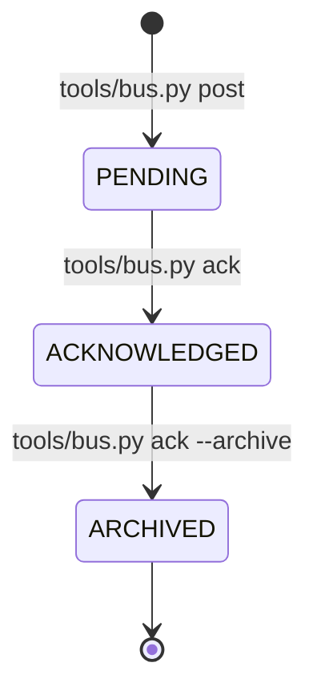

# Inter-Project Data Bus & Queue Specification (`docs/specs/inter_project_data_bus.md`)

## 1. Architectural Intent & Scope

The Klang Suite ecosystem spans five distinct local repositories and domains:
1. **The Klang Suite (`TKS`)**: JUCE 9.0.3 C++ audio DSP synthesis plugins (*The Klang Farmer*, *The Klang Planter*).
2. **ToadTracker (`TT`)**: Low-latency headless tracker engine and 500Hz SteamOS / Linux gamepad sequencer.
3. **N'kai (`NK`)**: Antigravity UI extension, multi-board hub, and interactive pair-programming companion.
4. **The Klang Research (`TR`)**: Centralized RFCs, DSP mathematics, subagent benchmarks, and QA autopsies.
5. **The Cosmos (`COSMOS`)**: Master Obsidian knowledge vault, creative worldbuilding, game design, and lore.

While each repository maintains an independent git commit history and build chain, they belong to **one cohesive creative and technical pipeline**. As development velocity accelerated, an ergonomic bottleneck emerged: **asynchronous cross-project handoffs**.

For example:
* When **The Klang Suite** establishes APVTS parameter schemas and VST3 64-bit UIDs, **ToadTracker** requires those exact identifiers to generate valid Renoise `.xrns` project files.
* When **ToadTracker** benchmarks Steam Deck controller polling latency, **The Klang Research** needs the raw timing benchmarks for its hardware whitepapers.
* When **The Cosmos** (Codex) drafts creative chronicles or discovers plugin UI gotchas, **The Foundry** needs structured tickets to update canonical lore or sidecar templates.

The **Inter-Project Data Bus** resolves this coordination challenge without the complexity of background network daemons, databases, or Redis brokers. It provides an instantaneous, file-based, zero-allocation messaging queue over the existing local NTFS junction.

```
┌────────────────────────────────────────────────────────────────────────┐
│                   INTER-PROJECT DATA BUS TOPOLOGY                      │
├────────────────────┬────────────────────┬──────────────────────────────┤
│ SUBSYSTEM          │ FILE LOCATION      │ CORE ROLE                    │
├────────────────────┼────────────────────┼──────────────────────────────┤
│ Shared Bus Conduit │ C:\_\Vault\🏢 NKC\  │ Universal file-based drop    │
│ (Dispatches/)      │ Dispatches\        │ box junctioned to dev root   │
├────────────────────┼────────────────────┼──────────────────────────────┤
│ Universal CLI      │ tools/bus.py       │ Standard-library Python CLI: │
│ Bus Controller     │ (mirrored in repos)│ post, list, read, ack        │
├────────────────────┼────────────────────┼──────────────────────────────┤
│ Master Dashboard   │ C:\_\Vault\        │ High-level human flight deck │
│ Presentation Layer │ Agenda.md          │ reflecting live queue state  │
├────────────────────┼────────────────────┼──────────────────────────────┤
│ Automated Tests    │ tools/tests/       │ Regression test suite        │
│                    │ test_bus.py        │ verifying packet lifecycle   │
└────────────────────┴────────────────────┴──────────────────────────────┘
```

---

## 2. Core Invariants & Architectural Rules

### 2.1 Zero-Daemon & Zero-Lock Principle
- **No Background Services**: The bus requires no running server, daemon process, or open TCP port.
- **Local Filesystem Proximity**: Packets are pure text files written directly to the junctioned `Dispatches/` directory. Reads and writes complete in sub-millisecond time.
- **Atomic Operations**: Marking a dispatch as acknowledged or archived uses atomic file overwrites or renames (`Path.replace()`), eliminating race conditions between concurrent agent turns.

### 2.2 Universal UTF-8 Invariant
All packet serialization, CLI stream output, and file parsing strictly enforce UTF-8:
- Python entrypoints call `sys.stdout.reconfigure(encoding='utf-8')` and `sys.stderr.reconfigure(encoding='utf-8')` to prevent Windows `cp1252` encoding crashes.
- All file I/O explicitly specifies `encoding='utf-8', errors='replace'`.

### 2.3 Strict Air-Gap Boundary
- The shared bus resides under `C:\_\Vault\🏢 New Klang City\Dispatches\` (junctioned to `C:\Dev\TheKlangVault\Dispatches\`).
- Repositories never write directly to private vault folders (`🎲 The Forge/`, `🧠 Codex/`, `🌿 Klang Confidential/`).
- Only designated handoff packets inside `Dispatches/` are inspected by dev tooling.

---

## 3. Data Packet Schema

Every dispatch packet is a human-readable and machine-parseable Markdown document with YAML frontmatter:

```yaml
---
id: "2026-10-12_tks_to_tt_the_klang_farmer_vst3_uid_and_"
date: "2026-10-12"
from: "TKS"
to: "TT"
tags: [tks, tt, vst3, xrns]
priority: "P1"
status: "PENDING"
title: "The Klang Farmer VST3 UID and Parameter Spec for Renoise XRNS"
---

# Title of Handoff

Detailed technical description, parameter mappings, JSON snippets, or next steps.

### 📦 Optional Attached Payload:
...
```

### Metadata Fields:
| Field | Type | Description |
| :--- | :--- | :--- |
| `id` | `string` | Deterministic timestamped slug: `YYYY-MM-DD_<from>_to_<to>_<slug>`. |
| `date` | `string` | ISO 8601 date string (`YYYY-MM-DD`). |
| `from` | `enum` | Originating pillar: `TKS`, `TT`, `NK`, `TR`, `COSMOS`. |
| `to` | `enum` | Target recipient pillar: `TKS`, `TT`, `NK`, `TR`, `COSMOS`, `ALL`. |
| `tags` | `list[str]` | Domain taxonomy tags: `#dsp`, `#xrns`, `#vst3`, `#lore`, `#ui`. |
| `priority` | `enum` | Urgency rating: `P0`, `P1`, `P2`, `P3`. |
| `status` | `enum` | Lifecycle state: `PENDING`, `ACKNOWLEDGED`. |
| `title` | `string` | Short human-readable summary. |

---

## 4. Packet Lifecycle State Machine



1. **`PENDING`**: Packet is created in `Dispatches/` by the sending project. Visible when running `python tools/bus.py list --for <PILLAR>`.
2. **`ACKNOWLEDGED`**: Recipient project agent inspects the payload and marks it received. Frontmatter records `status: "ACKNOWLEDGED"` and `acked_at: "<ISO timestamp>"`.
3. **`ARCHIVED`**: File is moved from `Dispatches/` into `Dispatches/Archive/` once implementation is complete, maintaining Inbox Zero in the active dispatch queue.

---

## 5. CLI Controller Reference (`tools/bus.py`)

The standard-library controller `tools/bus.py` is mirrored identically across `TheKlangSuite`, `nkai`, `ToadTracker`, and `The Cosmos`:

```bash
# List all active dispatches addressed to ToadTracker
python tools/bus.py list --for TT

# List all dispatches sent by The Klang Suite
python tools/bus.py list --from TKS

# Filter by domain tag
python tools/bus.py list --tag xrns

# Include archived historical dispatches
python tools/bus.py list --all

# Post a new cross-project handoff packet
python tools/bus.py post --to TT --title "Farmer VST3 UID" --tags tks,xrns --priority P1 --body "Payload..."

# Attach an external data file to the dispatch
python tools/bus.py post --to NK --title "Theme Tokens" --payload-file assets/themes/theme.json

# Read a dispatch by ID or filename substring
python tools/bus.py read "farmer_vst3"

# Acknowledge receipt
python tools/bus.py ack "farmer_vst3"

# Acknowledge and move to Archive/
python tools/bus.py ack "farmer_vst3" --archive
```

---

## 6. Dashboard Integration (`Agenda.md`)

The live state of the bus is reflected directly on the master flight deck in [`C:\_\Vault\Agenda.md`](file:///C:/_/Vault/Agenda.md):

```markdown
## 🛰️ Live Inter-Project Data Bus (`Dispatches/`)

| Date | Route | Priority | Status | Tags | Title & Payload |
| :---: | :---: | :---: | :---: | :--- | :--- |
| `2026-10-12` | **TKS ➔ TT** | `P1` | `PENDING` | `#tks` `#tt` `#vst3` `#xrns` | [[🏢 New Klang City/Dispatches/2026-10-12_tks_to_tt_the_klang_farmer_vst3_uid_and_\|The Klang Farmer VST3 UID and Parameter Spec for Renoise XRNS]] |
```

This guarantees that whether a user or agent opens Obsidian, runs a terminal CLI command, or inspects N'kai, the multi-repository state remains 100% transparent and synchronized.
