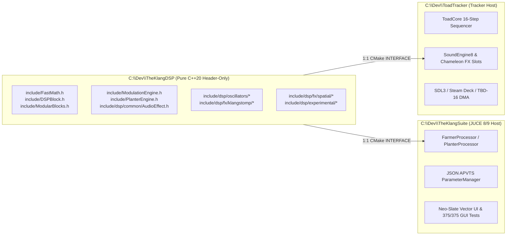

# Specification: TheKlangDSP Decoupling & 1:1 Cross-Ecosystem Consumption

## 1. Architectural Overview

**TheKlangDSP** ([`C:\Dev\TheKlangDSP`](file:///C:/Dev/TheKlangDSP)) has been extracted into a standalone, pure C++20, header-only, zero-dependency, hard real-time DSP repository. This architecture permanently eliminates code duplication between **TheKlangSuite** ([`C:\Dev\TheKlangSuite`](file:///C:/Dev/TheKlangSuite)) and **ToadTracker** ([`C:\Dev\ToadTracker`](file:///C:/Dev/ToadTracker)), guaranteeing that every oscillator, filter, stompbox, spatial modulator, and experimental granular processor behaves identically to the bit across desktop DAW plugins (VST3/CLAP/Standalone) and embedded/handheld tracker targets (Steam Deck, SDL3, dadamachines TBD-16 ESP32-P4, and Daisy Seed).

> [!IMPORTANT]
> **Zero-Duplication Invariant**: Neither `TheKlangSuite` nor `ToadTracker` maintains forked copies of DSP algorithms. Both projects link `TheKlangDSP` directly via CMake (`add_subdirectory` / `INTERFACE` target `TheKlangDSP::TheKlangDSP`) and include headers from `C:\Dev\TheKlangDSP\include\`.

---

## 2. Canonical Header Inventory in `TheKlangDSP`

| Subsystem | Header Paths (`C:\Dev\TheKlangDSP\include\`) | Primary Responsibility |
| :--- | :--- | :--- |
| **FastMath & Primitives** | `include/FastMath.h` | Rational Padé $[3/3]$ `fastTanh`, minimax `fastSin`/`fastCos`, IEEE-754 `fastPow2`, `PolyBLEP` (`alphaWave14`), FTZ/DAZ denormal flushing. |
| **Modular Block Core** | `include/DSPBlock.h`, `include/ModularBlocks.h` | 28-algorithm modular FX rack (ZDF SVF, Moog Ladder, `TransientShaperBlock`, `ThresherBlock`, `BalerBlock` OTT, `TheKlangMillBlock`). |
| **Modulation & Voice Engines** | `include/ModulationEngine.h`, `include/PlanterEngine.h` | 16-source × 64-route lock-free Hydra modulation matrix and multi-voice percussion synthesis core. |
| **Universal 8-Control Base** | `include/dsp/common/AudioEffect.h` | Pure virtual 8-parameter stereo contract (`prepare`, `reset`, `setParameter(0..7)`, `processStereo`). |
| **`SoundEngine8` Oscillators** | `include/dsp/oscillators/KlangJuno.h` (`AlphaKraft.h`), `KlangCZ.h` (`CosmoPhase.h`), `KlangFM.h` (`TheR1.h`), `KlangPluck.h` (`Pluck.h`), `ArgentSlayer.h` (`Klang808.h`) | 8-parameter macro-oscillators spanning Alpha Juno DCO + Supersaw, Casio CZ Phase Distortion, 4-Op FM + ER-1 Ring-Noise, Karplus-Strong waveguide, and 808 sub-punch. |
| **`KlangStomp` Pedals** | `include/dsp/fx/klangstomp/SwedishKlangSaw.h` (`BossHM2.h`), `KlangZone.h` (`BossMT2.h`), `Rodent.h` (`ProCoRat.h`), `GreenScreamer.h` (`IbanezTS9.h`), `RussianKlangPi.h` (`BigMuffPi.h`), `IxionGuild.h` (`KlonCentaur.h`), `Yellow250.h` (`DOD250.h`), `VelcroFace.h` (`FuzzFace.h`) | 8 nonlinear component-modeled analog distortion, overdrive, and fuzz pedals. |
| **Spatial & Modulation Lab** | `include/dsp/fx/spatial/KlangMod.h`, `KlangDelay.h`, `KlangSpace.h`, `EchoMill.h`, `Vocoder56K.h` | 8-mode BBD/Dimension/Ensemble chorus & flanger (`KlangMod`), recursive insert delay (`EchoMill`), algorithmic reverb (`KlangSpace`), and 56K vocoder (`Vocoder56K`). |
| **Experimental & Granular** | `include/dsp/experimental/KlangResonator.h`, `KlangFreeze.h`, `KlangBode.h`, `ArgentVortex.h`, `PhaseShriek.h`, `PipeAndWire.h` | 4-voice tuned modal waveguide bank, 4-grain Hann cloud freeze + Phrygian quantizer, Harald Bode Hilbert SSB frequency shifter, and physical spring/chaos processors. |

---

## 3. Dual-Alias Nomenclature Architecture

To maintain ironclad intellectual property hygiene (detailed in [`ROSETTA_STONE_MASTER_IP_REFERENCE.md`](file:///C:/Dev/Research/library/manuals/ROSETTA_STONE_MASTER_IP_REFERENCE.md)), `TheKlangDSP` implements a **Two-Tier Header Alias Architecture**:

1. **Primary Sovereign Implementation Headers**:
   All DSP classes are authored inside their trademark-clean Sovereign headers under `namespace KlangDSP` (and exposed in `TbdAudio`):
   - `SwedishKlangSaw` (`SwedishKlangSaw.h`)
   - `KlangZone` (`KlangZone.h`)
   - `Rodent` (`Rodent.h`)
   - `GreenScreamer` (`GreenScreamer.h`)
   - `RussianKlangPi` (`RussianKlangPi.h`)
   - `IxionGuild` (`IxionGuild.h`)
   - `Yellow250` (`Yellow250.h`)
   - `VelcroFace` (`VelcroFace.h`)
   - `AlphaKraft` / `KlangJuno`, `CosmoPhase` / `KlangCZ`, `TheR1` / `KlangFM`, `Pluck` / `KlangPluck`, `ArgentSlayer` / `Klang808`
2. **Backwards-Compatible Classic Alias Shims**:
   Classic reference filenames (`BossHM2.h`, `BossMT2.h`, `ProCoRat.h`, `IbanezTS9.h`, `BigMuffPi.h`, `KlonCentaur.h`, `DOD250.h`, `FuzzFace.h`) forward directly to the Sovereign headers and declare `using` type aliases (`using BossHM2 = SwedishKlangSaw;`). This provides 100% compatibility across legacy tests and research harnesses while keeping public UI strings and symbol exports strictly sovereign.

---

## 4. Real-Time Thread Safety & Numerical Invariants

All `TheKlangDSP` processors enforce five non-negotiable real-time invariants verified by `tools/audit_audiothread.py --strict` and `test/dsp_tests.cpp`:
1. **Zero Dynamic Memory Allocation**: All delay lines, granular freeze buffers (`65,536` floats), Karplus-Strong waveguides (`4,096` floats), and BBD delay lines are statically allocated in `std::array` members. Zero heap calls occur after construction.
2. **Zero CRT Transcendentals in Hot Loops**: Inner sample loops use rational Padé approximations (`FastMath::fastTanh`) and polynomial approximations, avoiding slow libc `std::tanh`/`std::pow` stalls.
3. **Denormal Flushing (FTZ/DAZ)**: Every recursive feedback path injects a $+10^{-18}\text{f}$ DC bias or flushes subnormal values (`std::abs(x) < 1e-15f ? 0.0f : x`) to prevent x86/ARM subnormal performance traps.
4. **Hard Output Safety Clamping ("Monitor Saver")**:
   - Individual `AudioEffect` and `SoundEngine8` processors clamp stereo outputs to `[-4.0f, 4.0f]` (+12 dBFS ceiling) and sanitize non-finite values (`!std::isfinite(x) -> 0.0f`).
   - Master modular buses in `ModularBlocks.h` clamp to `[-8.0f, 8.0f]` (+18 dBFS ceiling) with instant filter-state reset upon `NaN`/`Inf` detection.
5. **Standalone Catch2 Verification (`73/73` Test Cases, `36,518` Assertions)**:
   - Compiled and executed directly from `C:\Dev\TheKlangDSP\test\dsp_tests.cpp` and mirrored in `TheKlangSuite`, validating multi-rate stability ($44.1\,\text{kHz}$, $48\,\text{kHz}$, $96\,\text{kHz}$), finite bounds, and energy generation across all engines.
