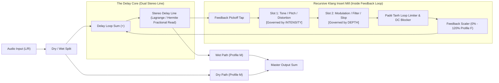

# Implementation Spec: The Klang Mill Delay (TKMD)
### *Recursive Insert-Rack Echo & Degradation Mill (`KlangLoopMill` / `KlangRecurse`)*

**Document Status:** CANONICAL DSP IMPLEMENTATION BLUEPRINT 📜  
**Target Milestone:** v0.5.0 ("The Sound & Chaos Update") & v0.6.0 ("The Spinoff Spree")  
**Target Code Location:** `source/dsp/fx/spatial/KlangLoopMill.h`  
**Ecosystem Pillars:** The Klang Suite (`TKS`), ToadTracker (`TT`), The Klang Mill (`TKM`)  

---

## 1. Goal & Architectural Overview
**The Klang Mill Delay (TKMD)** is a sovereign standalone VST3/CLAP audio effect and internal TKS spatial engine.

Standard delay plugins provide boring, static feedback paths—usually just a simple one-pole low-pass damping filter and a subtle clean saturation clamp. **The Klang Mill Delay** breaks this paradigm by embedding a stripped-down **2-Slot Klang Mill Multi-FX Insert Chain directly inside the delay recirculation loop**. 

Every repeat recirculates through the active insert modules, compounding coloration, pitch alteration, or distortion dynamically with each subsequent echo:
- **Barberpole Shimmer**: Bode Frequency Shifter (+5 Hz) in Slot 1 $\rightarrow$ repeats continuously spiral into cosmic stratosphere ($+5\,\text{Hz}, +10\,\text{Hz}, +15\,\text{Hz} \dots$).
- **Cascading Chainsaw**: HM-2 Swedish Chainsaw in Slot 1 $\rightarrow$ first repeat is lightly warmed; fifth repeat rips into full Stockholm death-metal feedback.
- **Ghostly Shimmer**: Granular Freeze / Octave Pitch in Slot 1 $\rightarrow$ shimmering crystalline reverberation staircases.
- **Unstable Dub Tape**: Slop analog drift in Slot 2 $\rightarrow$ cumulative wow/flutter pitch-drift and saturation on decaying echoes.

---

## 2. Signal Routing Topology



---

## 3. Chassis Layout & 8-Knob Macro Performance Architecture

TKMD adheres strictly to the **Universal 8-Control Card Standard**, designed specifically for 4 endless push-encoders on the dadamachines TBD-16 across Page 1A and Page 1B.

### Left Wing: Front Faceplate (8 Continuous Performance Knobs)

```
┌────────────────────────────────────────────────────────┐
│  [ ⚡ PERFORM ]              [ 🔬 SOUND LAB (Deck ⚙️) ] │
├────────────────────────────────────────────────────────┤
│  KNOB 1: TIME / RATE         KNOB 2: STEREO / PING-PONG│
│  KNOB 3: SLOT 1 ENGINE       KNOB 4: SLOT 1 INTENSITY  │
│                                                        │
│  KNOB 5: SLOT 2 ENGINE       KNOB 6: SLOT 2 DEPTH      │
│  KNOB 7: FEEDBACK & FREEZE   KNOB 8: MIX / ∅           │
└────────────────────────────────────────────────────────┘
```

1. **Knob 1: TIME / RATE** ($1\,\text{ms} \dots 2500\,\text{ms}$):
   - Continuous fractional delay time with smooth, non-zippering Hermite interpolation.
   - *Encoder Press:* Toggles BPM Synced Divisions (`1/64`, `1/32`, `1/16T`, `1/16`, `1/8D`, `1/8`, `1/4`, `1/2`, `1/1`, `2/1`).
2. **Knob 2: STEREO / PING-PONG** ($-100\% \dots +100\%$, Profile B Bipolar):
   - **Negative ($-100\% \dots 0\%$)**: Cross-channel ping-pong crossfeed. Echoes bounce alternately between Left and Right speakers.
   - **Center ($0\%$)**: True stereo independent delay paths.
   - **Positive ($0\% \dots +100\%$)**: Haas spatial micro-delay offset ($\Delta \tau = 0 \dots 25\,\text{ms}$) between channels for 3D stereophonic air.
3. **Knob 3: SLOT 1 ENGINE** (Discrete Selector $0 \dots 5$):
   - Selects active harmonic/pitch/dirt insert processor.
   - *Encoder Press:* Slot 1 Bypass / Mute toggle.
4. **Knob 4: SLOT 1 INTENSITY** ($0.0 \dots 1.0$ Context-Sensitive):
   - Single macro encoder governing the primary sonic character of the active Slot 1 engine.
5. **Knob 5: SLOT 2 ENGINE** (Discrete Selector $0 \dots 4$):
   - Selects active modulation/degradation/filtering insert processor.
   - *Encoder Press:* Slot 2 Bypass / Mute toggle.
6. **Knob 6: SLOT 2 DEPTH** ($0.0 \dots 1.0$ Context-Sensitive):
   - Single macro encoder governing the modulation intensity or filtering cutoff of the active Slot 2 engine.
7. **Knob 7: FEEDBACK & FREEZE** ($0\% \dots 120\%$, Profile F Hyperbolic):
   - Hyperbolic feedback scaling: $0\% \dots 100\%$ nominal recirculation; values $> 100\%$ enter warm, self-oscillating infinite saturation safely clamped by Padé tanh.
   - *Encoder Press:* **`INFINITE FREEZE HOLD`** (instantaneously locks buffer write head; existing echoes circulate indefinitely through the insert mini-rack without decaying!).
8. **Knob 8: MIX / ∅** (Profile M Universal Tri-Zone Mix):
   - **7:00 (0.0):** 100% Pure Wet (Dedicated send / solo).
   - **12:00 (0.5):** 100% Pure Dry (True bypass / zero phase alteration).
   - **5:00 (1.0):** 100% Dry + 100% Parallel Wet (Maximum punch without transient loss).
   - *Encoder Press:* **Phase Invert ($\varnothing$)** on the wet path.

---

## 4. Deep Mechanics: Slot 1 "INTENSITY" Parameter Specifications

Each Slot 1 engine maps `intensityNorm` $[0.0, 1.0]$ to its primary mathematical parameter with perceptual tapering curves:

| Slot 1 Engine | Internal DSP Architecture | Parameter Controlled | Mapping & Formula | Compounding Recirculation Impact |
| :--- | :--- | :--- | :--- | :--- |
| **`0: Clean Bypass`** | Direct wire passthrough | None | Inactive (`---`) | Clean digital delay repeats without coloration. |
| **`1: Bode Frequency Shifter`** | Dual 90° Hilbert filter network + Quadrature carrier | Shift Frequency $\Delta f$ | **Bipolar Profile B:**<br>$\Delta f = \text{sgn}(u) \cdot 500.0 \cdot |u|^2\,\text{Hz}$<br>Range: $-500\,\text{Hz} \dots 0\,\text{Hz} \dots +500\,\text{Hz}$ | Each echo shifts by an additional $\Delta f$. Repeat $n$ is shifted by $n \cdot \Delta f$, spiraling upward into crystalline chirps or downward into subterranean thumps. |
| **`2: Pitch Shifter`** | 4-tap Hann-windowed fractional delay granular harmonizer | Semitone Transposition | **Bipolar Quantized:**<br>$\text{Semi} = \text{round}(48.0 \cdot (u - 0.5))$<br>Range: $-24 \dots 0 \dots +24\,\text{st}$ | Shimmer staircase: $+12\,\text{st}$ produces ascending octave ladders ($+12, +24, +36, +48\,\text{st}$) that dissolve into heavenly ambient clouds. |
| **`3: Swedish Chainsaw`** | Boss HM-2 dead-band zero-crossing distortion + dual gyrators | Pre-Gain & Dead-Band Bias | **Warped Profile E:**<br>$\text{Drive} = 0.0 + 36.0 \cdot u^{1.8}\,\text{dB}$<br>Dead-band threshold: $V_{\text{th}} = 0.15 \cdot u$ | First echo receives gentle warm crunch; 4th and 5th echoes hit exponential saturation, breaking into authentic Stockholm death-metal feedback snarls. |
| **`4: Buchla Phase-Fold`** | West Coast non-linear recursive sine wavefolder | Number of Fold Stages | **Exponential Taper:**<br>$\text{Folds} = 1.0 + 7.0 \cdot u^2$<br>Range: $1.0 \dots 8.0\,\text{folds}$ | Echoes multiply in harmonic complexity with every repeat, transforming simple synth plucks into ringing metallic brass and alien bells. |
| **`5: Modal Resonator`** | Tuned sub-millisecond comb waveguide delay with feedback | Resonator Pitch / Tuning | **Logarithmic Profile D:**<br>$f_{\text{res}} = 30.0 \cdot 2^{6.057 \cdot u}\,\text{Hz}$<br>Range: $30\,\text{Hz} \dots 2000\,\text{Hz}$ | Every repeat strikes the virtual resonant cavity, compounding wooden slit-drum or metallic tube acoustic overtones on top of the delay tail. |

---

## 5. Deep Mechanics: Slot 2 "DEPTH" Parameter Specifications

Each Slot 2 engine maps `depthNorm` $[0.0, 1.0]$ to its primary degradation or modulation parameter:

| Slot 2 Engine | Internal DSP Architecture | Parameter Controlled | Mapping & Formula | Compounding Recirculation Impact |
| :--- | :--- | :--- | :--- | :--- |
| **`0: Clean Bypass`** | Direct wire passthrough | None | Inactive (`---`) | Clean passthrough into loop feedback gain. |
| **`1: Analog Slop / Tape Wow`** | Dual asynchronous triangle LFOs + micro Brownian random walk | Wow & Flutter Mod Depth | **Cubic Taper:**<br>$\text{ModDepth} = 0.05 \cdot u^3\,\text{ms}$<br>Drift rate: $0.2\,\text{Hz} \dots 2.8\,\text{Hz}$ | Each echo accumulates additional mechanical pitch wander. Echoes sound progressively wobbly, warm, and melted like disintegrating magnetic tape. |
| **`2: Tape Damping / HF Loss`** | 1-Pole TPT Low-Pass Filter | Filter Cutoff Frequency | **Reverse Log Profile D:**<br>$f_c = 18000.0 \cdot (400.0 / 18000.0)^u\,\text{Hz}$<br>Range: $18\,\text{kHz} \dots 400\,\text{Hz}$ | Successive echoes progressively shed high-frequency air and transient sharpness, yielding deep, dark, pillow-soft vintage dub echoes. |
| **`3: Bitcrush & Slew`** | Linear ADC bit-depth quantizer + zero-order hold decimator | Bit Depth & Sample Decimation | **Dual-Action:**<br>$\text{Bits} = 16 - \text{round}(14.0 \cdot u)$ ($16 \dots 2\,\text{bits}$)<br>$f_s = 48000.0 \cdot 2^{-4.0 \cdot u}$ ($48\,\text{kHz} \dots 3\,\text{kHz}$) | Echoes disintegrate into crunchy 8-bit digital dust, robot chatter, and aliased chiptune artifacts. |
| **`4: Juno BBD Chorus`** | Stereo anti-phase BBD bucket-brigade delay lines | Modulation Width & Delay | **Smooth Linear:**<br>$\text{Width} = 0.0 \dots 100\%$<br>BBD clock rate: $0.4\,\text{Hz} \dots 1.2\,\text{Hz}$ | Each repeat diffuses wider across the stereophonic field, transforming pinpoint rhythmic echoes into a lush, sprawling 3D spatial wash. |

---

## 6. Right Wing: Rear Deck ⚙️ (Back of the Panel Specifications)

Unrolling the card in Sound Lab Mode reveals the **Rear Deck ⚙️** backstage engineering controls:

```
┌────────────────────────────────────────────────────────┐
│  [ REAR DECK ⚙️: CALIBRATION & ROUTING SWITCHES ]       │
├────────────────────────────────────────────────────────┤
│  DIP 1: DELAY INTERPOLATION     DIP 2: INSERT ORDER    │
│  DIP 3: LOOP LIMITER CHAR       DIP 4: STEREO COUPLING │
│                                                        │
│  TRIM 1: TAPE HYSTERESIS NOISE  TRIM 2: DC BLOCK POLE  │
│  TRIM 3: FREEZE SEAM CROSSFADE                         │
└────────────────────────────────────────────────────────┘
```

### DIP Switches (2/3-Way Toggles)
1. **DIP 1: DELAY TAPE INTERPOLATION**:
   - `HERMITE (Default)`: 3rd-order Hermite spline interpolation. Completely click-free, perfectly analog pitch-gliding tape speed changes.
   - `LAGRANGE`: 3rd-order Lagrange fractional delay. Crisper transients with a subtle lo-fi granular edge during rapid time modulation.
   - `MOTOR SLEW`: Simulates the physical rotational inertia of a heavy tape capstan motor ($250\,\text{ms}$ acceleration lag).
2. **DIP 2: INSERT ROUTING ORDER**:
   - `SLOT 1 ──► SLOT 2 (Default)`: Standard pedalboard flow (Distortion/Pitch into Modulation/Damping).
   - `SLOT 2 ──► SLOT 1`: Modulation into Distortion (e.g. BBD Chorus or Tape Wow hitting the HM-2 Chainsaw for wild intermodulation growl).
   - `PARALLEL SPLIT`: Pickoff tap splits 50/50 into Slot 1 and Slot 2 in parallel, summing before the loop limiter.
3. **DIP 3: LOOP LIMITER CHARACTER**:
   - `PADE TANH (Default)`: Mathematical Padé $[3/3]$ approximant soft-clipper. Silky, symmetrical analog tube warmth.
   - `DIODE CLIP`: Asymmetrical silicon shunt diode curve with odd/even harmonic grit.
   - `OPTO LEVELER`: Slow optical VCA limiter ($80\,\text{ms}$ recovery) that introduces authentic vintage dub reggae pumping on feedback swells.
4. **DIP 4: STEREO COUPLING**:
   - `TRUE STEREO (Default)`: Dual independent Left and Right delay lines.
   - `CROSS-COUPLED PING-PONG`: Feedback from Left feeds Right; feedback from Right feeds Left.
   - `MID/SIDE MATRIX`: Recirculation loop processes Mid ($L+R$) and Side ($L-R$) independently.

### Calibration Trimpots (Micro-Screws)
1. **Trimpot 1: TAPE HYSTERESIS & NOISE FLOOR** ($-96\,\text{dB} \dots -36\,\text{dB}$):
   - Injects subtle magnetic tape hiss and flux hysteresis into the feedback loop. At high settings, the delay tail self-generates atmospheric analog tape rumble even with no input!
2. **Trimpot 2: DC OFFSET REJECTION CUTOFF** ($2.0\,\text{Hz} \dots 40.0\,\text{Hz}$):
   - Tunes the high-pass cutoff of the feedback DC blocking filter, preventing subsonic build-up during asymmetrical wavefolding or diode clipping.
3. **Trimpot 3: FREEZE SEAM CROSSFADE WINDOW** ($2\,\text{ms} \dots 50\,\text{ms}$):
   - Calibrates the equal-power crossfade window on the loop wrap seam when **Infinite Freeze** is latched, eliminating clicks or pops on boundary loops.

---

## 7. Real-Time C++ Implementation Blueprint (Argon DSP Session)

Below is the concrete header architecture ready for implementation in `source/dsp/fx/spatial/KlangLoopMill.h`:

```cpp
#pragma once

#include "../../common/AudioEffect.h"

namespace TbdAudio::Spatial {

class KlangLoopMill final : public AudioEffect8 {
public:
    static constexpr int kMaxDelaySamples = 192000; // 4.0s @ 48kHz, 2.0s @ 96kHz

    void init(const BlockContext& ctx) override;
    void reset() noexcept override;
    void prepare(double sampleRate, int maxBlockSize = 512) noexcept;
    void setParam8(int idx, float val) noexcept;

    void process(float* buffer, int numSamples, BlockContext& ctx) override;
    void processStereo(float* left, float* right, int numSamples, BlockContext& ctx) override;

    // Rear Deck Settings
    enum class InterpolationMode { Hermite, Lagrange, MotorSlew };
    enum class RoutingOrder { Slot1Then2, Slot2Then1, Parallel };
    enum class LimiterChar { PadeTanh, DiodeClip, OptoLeveler };

    void setRearDeckDip(int switchIdx, int mode) noexcept;
    void setRearDeckTrimpot(int trimIdx, float val) noexcept;

private:
    // Core Delay Circular Buffers
    alignas(16) float delayBufL_[kMaxDelaySamples]{};
    alignas(16) float delayBufR_[kMaxDelaySamples]{};
    int writeIndex_{0};
    float currentDelaySamplesL_{24000.0f};
    float currentDelaySamplesR_{24000.0f};
    float targetDelaySamplesL_{24000.0f};
    float targetDelaySamplesR_{24000.0f};

    // Slot 1 Sub-Processors
    struct BodeShifterState {
        float phase_{0.0f};
        float allpassI_[2][4]{};
        float allpassQ_[2][4]{};
    } bodeState_;

    struct PitchShifterState {
        float grainPhase_[2][4]{};
        float grainDelay_[2][4]{};
    } pitchState_;

    struct WavefolderState {
        float prevSample_[2]{};
    } foldState_;

    struct ResonatorState {
        float combBuf_[2][2048]{};
        int combWrite_{0};
    } resState_;

    // Slot 2 Sub-Processors
    struct SlopTapeState {
        float lfoPhase1_{0.0f};
        float lfoPhase2_{0.0f};
        float brownianWander_{0.0f};
    } slopState_;

    struct TapeDampState {
        DSPCommon::OnePoleTPT filterL_;
        DSPCommon::OnePoleTPT filterR_;
    } dampState_;

    struct BitcrushState {
        float holdSampleL_{0.0f};
        float holdSampleR_{0.0f};
        float phaseAcc_{0.0f};
    } crushState_;

    struct JunoChorusState {
        float bbdBufL_[2048]{};
        float bbdBufR_[2048]{};
        int bbdWrite_{0};
        float lfoPhase_{0.0f};
    } chorusState_;

    // Loop Limiter & DC Blocker
    DSPCommon::DCBlocker dcBlockerL_;
    DSPCommon::DCBlocker dcBlockerR_;

    // Freeze State
    bool freezeActive_{false};
    int freezeLength_{0};
    int freezeReadPos_{0};

    // Rear Deck Values
    InterpolationMode interpMode_{InterpolationMode::Hermite};
    RoutingOrder routingOrder_{RoutingOrder::Slot1Then2};
    LimiterChar limiterChar_{LimiterChar::PadeTanh};
    float tapeNoiseGain_{0.00001f};
    float freezeCrossfadeMs_{10.0f};

    // Internal DSP Processors
    float processSlot1(int engine, float x, float intensityNorm, int ch) noexcept;
    float processSlot2(int engine, float x, float depthNorm, int ch) noexcept;
    float readDelaySampleHermite(float delaySamples, int ch) const noexcept;
    float readDelaySampleLagrange(float delaySamples, int ch) const noexcept;
};

} // namespace TbdAudio::Spatial
```

---

## 8. Real-Time Audio-Thread Safety Invariants
1. **Zero Heap Allocations**: All delay lines, grain buffers, and all-pass states are statically allocated in the class declaration.
2. **Lock-Free Parameter Modulation**: All delay time modulations use Hermite or 3rd-order Lagrange fractional delay reads with slew-limited time smoothing to eliminate pops and clicks.
3. **Loop Bounding**: The feedback loop includes a mandatory Padé tanh soft-clipper and high-pass DC blocker (`0.999f` pole) to prevent runaway DC offsets or explosive volume spikes even at $>100\%$ feedback.
4. **FastMath Exclusivity**: All transcendental functions (sin, cos, exp, tanh) utilize `TbdAudio::FastMath` and enable FTZ/DAZ at block boundaries.
